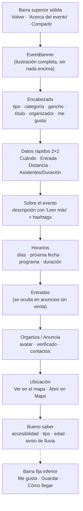
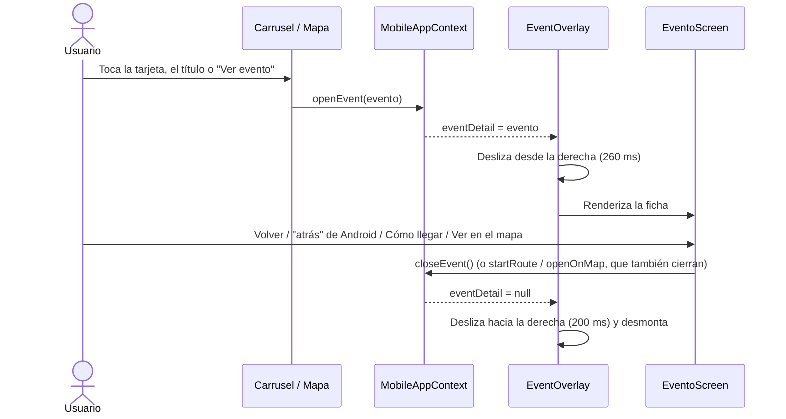
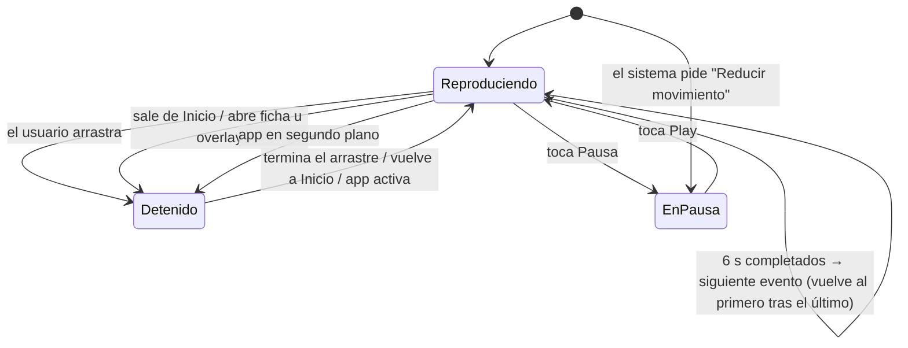

# 🎟️ Eventos en la App Móvil: Ficha "Acerca del evento", Tipos de Evento y Carrusel

Este documento describe el módulo de **eventos** de la experiencia móvil nativa (`app-turismo/src/mobile`): la ficha de detalle "Acerca del evento", los tres eventos destacados por defecto, la clasificación por **tipo de evento** y el carrusel automático **"Eventos cerca de ti"** de Inicio.

> Alcance: solo la vista móvil nativa (Android / iOS), que se monta desde `app/(home)/index.tsx` cuando `Platform.OS !== 'web'`.

| PR | Contenido |
|---|---|
| [#14](https://github.com/Grivyzom/app-turismo-map/pull/14) | Ficha "Acerca del evento", banner de ilustración, me gusta / guardar |
| [#15](https://github.com/Grivyzom/app-turismo-map/pull/15) | Tres eventos destacados con ilustraciones originales e imágenes empaquetadas |
| [#16](https://github.com/Grivyzom/app-turismo-map/pull/16) | Tipos de evento (diario / algunos días / publicitario) y carrusel automático |

---

## 🗺️ Mapa de Archivos

| Archivo | Rol |
|---|---|
| `src/mobile/screens/EventoScreen.tsx` | **Nuevo.** Ficha "Acerca del evento" + `EventOverlay` (animación de entrada y salida) |
| `src/mobile/components/EventBanner.tsx` | **Nuevo.** Banner de la ilustración y visor a pantalla completa |
| `src/mobile/components/EventKindBadge.tsx` | **Nuevo.** Etiqueta del tipo de evento y frase gancho |
| `src/mobile/data/eventInfo.ts` | **Nuevo.** Utilidades de presentación: fechas, estado, precio, ganchos, días |
| `src/mobile/data/defaultEvents.ts` | **Nuevo.** Los tres eventos destacados por defecto |
| `assets/events/*.webp` | **Nuevo.** Ilustraciones originales (2000×1333, ~90 KB c/u) |
| `src/mobile/sections/EventsCarousel.tsx` | **Reescrito.** Carrusel de a una tarjeta con avance automático |
| `src/mobile/MobileAppContext.tsx` | Estado `eventDetail`, `openEvent`, `closeEvent`, `toggleLikedEvent` |
| `src/mobile/MobileApp.tsx` | Monta `EventOverlay` sobre las pestañas y el dock; "atrás" de Android |
| `src/mobile/hooks/usePlacesData.ts` | Mezcla los eventos por defecto; filtra el carrusel a eventos con banner |
| `src/mobile/hooks/useMobilePreferences.ts` | Nueva preferencia `likedEventIds` |
| `src/mobile/data/routes.ts` | `singleStopRoute()` movido aquí (lo usan el Mapa y la ficha) |
| `src/mobile/components/ui.tsx` | `Thumb` acepta imágenes empaquetadas (`asset`) |
| `src/mobile/screens/MapaScreen.tsx` | Botón "Ver evento" en la tarjeta del lugar seleccionado |
| `src/mobile/utils/external.ts` | `openLink()` y texto extra al compartir |
| `src/components/Map/types.ts` | Nuevos campos opcionales en `TurismoEvent` |

---

## 🧱 Modelo de Datos: Campos Nuevos en `TurismoEvent`

Todos son **opcionales**. La ficha funciona solo con los campos que ya enviaba el backend (`title`, `description`, `organizer`, `time`, `imageUrl`, `address`) y muestra "Por confirmar" donde falta información.

| Campo | Tipo | Uso |
|---|---|---|
| `imageAsset` | `number` | Ilustración empaquetada (`require('…webp')`). Tiene prioridad sobre `imageUrl` |
| `imageWidth` / `imageHeight` | `number` | Dimensiones originales: reservan el alto del banner sin saltos de layout |
| `startTime` / `endTime` | `string` (ISO 8601) | Próxima ocurrencia; de aquí salen "Cuándo", el estado y la duración |
| `schedule` | `{ label, time }[]` | Programa por bloques ("Apertura · 19:00") |
| `price` | `number` (CLP) | `0` = gratis; sin valor = no informado |
| `priceLabel` | `string` | Texto libre del precio ("Entrada liberada", "Desde $5.000") |
| `ticketUrl` / `website` | `string` | Botón "Comprar entradas" / "Reservar cupo" y enlace del organizador |
| `organizerAvatarUrl` / `organizerVerified` / `organizerType` | | Tarjeta del organizador |
| `likesCount` | `number` | Contador base de "me gusta" |
| `capacity` / `ageRestriction` | | Cupos y restricción de edad |
| `accessibility` / `tips` | `string[]` | Sección "Bueno saber" |
| `tags` / `sectorName` | | Hashtags y sector |
| `eventKind` | `'diario' \| 'dias' \| 'publicitario'` | Tipo de evento (ver más abajo) |
| `weekdays` | `number[]` | Días en que ocurre (0 = domingo … 6 = sábado) |

> ⚠️ **Pendiente de backend:** la API `/api/v1/places/search` todavía no envía la mayoría de estos campos. Conviene exponer al menos `startTime`/`endTime` (ya existen en la tabla de eventos) e `imageWidth`/`imageHeight`.

---

## 📄 Ficha "Acerca del evento"

### Estructura de la pantalla



### Reglas del banner de ilustración (`EventBanner`)

Las ilustraciones son piezas únicas del equipo de diseño; el banner las muestra **tal cual**:

- **Sin efectos:** no tiene degradados, desenfoques ni sombras, y ningún texto ni botón se dibuja sobre la obra. Volver y Compartir viven en una barra aparte.
- **Sin recortes:** el alto se calcula con la proporción original (`resizeMode="contain"`). Si la obra es más vertical que 4:5 o más panorámica que 21:9, se muestra entera con márgenes del color de fondo.
- **Sin fundido de entrada** (`fadeDuration={0}`) ni carga progresiva borrosa.
- **Rendimiento:** en Android se decodifica al tamaño físico del banner (`resizeMethod="resize"`), con nitidez completa a la densidad de la pantalla sin gastar memoria en píxeles que no se ven.
- **Visor a pantalla completa:** al tocar la obra se abre sobre fondo negro a resolución original, con zoom en iOS.
- **Proporción conocida de antemano:** sale de `imageWidth`/`imageHeight`, de `Image.resolveAssetSource` (assets empaquetados, solo nativo) o del evento `onLoad`.

> 🐛 **Bug corregido (PR #15):** con `require()`, React Native le asigna por defecto a `<Image>` las dimensiones del archivo (2000×1333) y `absoluteFill` no las sobrescribe, así que la ilustración desbordaba el banner. Ahora `EventBanner` y `Thumb` fijan `width/height: '100%'` y el contenedor recorta (`overflow: 'hidden'`).

### Datos calculados (`data/eventInfo.ts`)

| Función | Devuelve |
|---|---|
| `eventWhen(e)` | Día ("Hoy", "Mañana", "Sábado 18 de octubre") y rango horario |
| `eventStatus(e)` | `en_curso` · `pronto` ("Empieza en 2 h", si falta menos de 24 h) · `agendado` · `finalizado` |
| `eventDuration(e)` | "3 h", "1 h 30 min", "2 días" |
| `eventPrice(e)` | "Gratis", "$25.000" (formato CLP) o "Por confirmar" |
| `eventHook(e)` | Etiqueta del tipo + frase gancho (ver sección de tipos) |
| `weekdaysLabel(days, long?)` | "Todos los días", "Sáb y dom", "Mar a sáb" / "De martes a sábado" |
| `hasBanner(e)` | `true` si el evento tiene ilustración propia |

Otros comportamientos de la ficha:
- La **descripción** se colapsa a 5 líneas cuando supera los 220 caracteres.
- La **distancia** se toma de la versión viva del lugar, así que se actualiza con el GPS.
- **"Bueno saber"** agrega un aviso de lluvia cuando el pronóstico es lluvioso y la categoría es al aire libre.
- Con un evento **finalizado**, "Cómo llegar" queda deshabilitado y se oculta la compra de entradas.

---

## 🔁 Flujos Añadidos

### Abrir y cerrar la ficha



- **Puntos de entrada:** el carrusel de Inicio (tarjeta, título o "Ver evento") y la tarjeta del Mapa ("Ver evento", solo en eventos).
- **Superposición:** `EventOverlay` se monta **sobre el dock** (`TabBar`), porque la ficha tiene su propia barra de acciones.
- **Animación de salida:** se ejecuta venga de donde venga el cierre, incluido el botón "atrás" de Android, que en `MobileApp.tsx` cierra primero la ficha.

### Acciones de la ficha

| Acción | Efecto |
|---|---|
| **Cómo llegar** | `startRoute(singleStopRoute(evento))`: cierra la ficha y abre la navegación a pie en la pestaña Rutas |
| **Ver en el mapa** | `openOnMap(evento)`: pestaña Mapa con el evento seleccionado |
| **Abrir en Maps** | Indicaciones a pie en Google Maps / Apple Maps |
| **Me gusta** | `toggleLikedEvent(id)`: se guarda en `prefs.likedEventIds` (local); el contador muestra `likesCount + 1` |
| **Guardar** | `toggleSavedEvent(id)`: `prefs.savedEventIds` (local). El ícono cambió de corazón a **marcador** en toda la app, para no confundirlo con "Me gusta" |
| **Compartir** | Hoja nativa con título, fecha, dirección y enlace de Google Maps |
| **Contactos** | `tel:`, `mailto:`, sitio web, Instagram y Facebook ("@usuario" o URL) |

> ℹ️ "Me gusta" y "Guardar" son **locales** (AsyncStorage). No existe aún un endpoint de likes en el backend.

---

## 🏷️ Tipos de Evento

Cada evento puede declarar `eventKind` y `weekdays`. El tipo define la **etiqueta** y una **frase gancho** que cambia según el momento, pensada para despertar la curiosidad ("¡Oh! Hoy otra vez se puede").

| Tipo | Cuándo usarlo | Etiqueta | Antes (hoy) | Durante | Después / otro día |
|---|---|---|---|---|---|
| `diario` | Experiencia que una empresa ofrece todos los días | 🔁 Todos los días | "Hoy nuevamente, desde las 10:00" | "¡Ahora mismo! Disponible hasta las 13:00" | "Mañana nuevamente, desde las 10:00" |
| `dias` | Actividad que solo ocurre algunos días | 📅 Sáb y dom | "¡Hoy sí hay! Desde las 11:00" | "¡Hoy sí hay! Disponible hasta las 17:00" | "Vuelve el sábado a las 11:00" |
| `publicitario` | Un local avisa que hoy abre como siempre | 📣 Anuncio | "Hoy abre a las 19:00" | "Abierto ahora, hasta las 03:00" | "Abre el martes a las 19:00" |

Reglas de presentación:
- 🔴 Un **punto rojo** junto al gancho marca lo que ocurre **hoy**.
- Cuando hay gancho, el estado ("Empieza en 18 h", "Agendado") **no se muestra**, porque repetiría lo mismo.
- En la ficha, **Horarios** agrega los días en forma larga ("Sábados y domingos", "De martes a sábado") con la nota correspondiente: "Se repite todos los días", "Solo estos días de la semana" u "Horario habitual del local".
- En `publicitario`, el organizador aparece como **"Anuncia"** y la tarjeta **Entradas** se oculta si no hay `ticketUrl`.
- Los eventos **sin** `eventKind` siguen funcionando como antes (fecha y estado).

### Recurrencia

`recurring(weekdays, hora, minuto, duración, ahora)` en `defaultEvents.ts` calcula `startTime`/`endTime`. Busca desde **ayer** hasta 7 días adelante la primera ocurrencia que aún no terminó. Así cumple dos cosas:
- Un evento **nunca aparece vencido**.
- Un evento que **cruza la medianoche** sigue "en curso" de madrugada. Por ejemplo, Grado 13 el sábado a la 1:30 todavía figura como abierto desde el viernes.

---

## 🎠 Carrusel "Eventos cerca de ti"

### Qué cambió

| Antes | Ahora |
|---|---|
| Mostraba cualquier evento, y si no había, rellenaba con lugares cercanos | **Solo eventos con banner** (`hasBanner`), sin relleno |
| Tarjeta con la siguiente asomando (44 px) | **Una tarjeta a la vez**: cada página mide exactamente el ancho de pantalla |
| Miniatura de 130 px recortada, con hora y "Guardar" encima | Ilustración **completa en su proporción**, sin nada encima |
| Paginación manual (flechas, "1 de 3") | **Avance automático** con barra de progreso por evento |

### Tarjeta

Ilustración → etiqueta de tipo + categoría → **gancho** → título → organizador · distancia → `[Guardar] [Ver evento] [Cómo llegar]`.

### Avance automático



- **Intervalo:** `AUTOPLAY_MS = 6000`. Cada evento tiene un segmento que se llena (animación con *native driver*).
- **Navegación:** los segmentos se pueden tocar para saltar a un evento.
- **Pausa:** el botón detiene o reanuda el avance. Cumple con WCAG 2.2.2 (contenido en movimiento pausable).
- **Accesibilidad:** si el sistema tiene activado **Reducir movimiento**, el carrusel arranca en pausa y el botón de play lo activa. Cada tarjeta anuncia su posición y su gancho al lector de pantalla.

---

## ⭐ Eventos Destacados por Defecto

Definidos en `src/mobile/data/defaultEvents.ts` y mezclados en `usePlacesData`, junto con el catálogo local y la API. Se muestran mientras el backend no publique eventos propios.

| | 🛶 Kayak | 🌳 Canopy | 🌙 Grado 13 |
|---|---|---|---|
| **Título** | Travesía en kayak por el río Valdivia | Canopy en el Parque Saval | Hoy en Grado 13 |
| **Tipo** | `diario` | `dias` | `publicitario` |
| **Días y horario** | Todos los días 10:00–13:00 | Sáb y dom 11:00–17:00 | Mar a sáb desde las 19:00 (hasta 03:00) |
| **Organiza** | Río Vivo Kayak (ficticio) | Municipalidad de Valdivia | Grado 13 (restobar) |
| **Entrada** | $25.000 | Gratis | Entrada liberada |
| **Lugar** | Muelle de la Costanera Arturo Prat | Parque Saval, Isla Teja | Calle Esmeralda |
| **Ilustración** | `kayak-rio-valdivia.webp` | `canopy-parque-saval.webp` | `noche-esmeralda.webp` |

### Cómo agregar un evento destacado

1. Copia la ilustración a `app-turismo/assets/events/` (WebP o PNG, en su resolución original).
2. Agrega un objeto en `buildDefaultEvents()`:

```ts
{
  id: 'destacado-mi-evento',               // único
  title: 'Mi evento',
  description: '…',
  latitude: -39.81, longitude: -73.24,
  category: 'cultura',
  status: 'agendado',                      // lo marca como evento para el carrusel
  eventKind: 'dias',                       // 'diario' | 'dias' | 'publicitario'
  organizer: 'Quien lo publica',
  time: 'Jueves 18:00 – 20:00',            // texto de respaldo
  imageAsset: require('../../../assets/events/mi-evento.webp'),
  imageWidth: 2000, imageHeight: 1333,     // dimensiones reales del archivo
  ...recurring([4], 18, 0, 120, now),      // jueves 18:00, dura 120 min → weekdays + fechas
  price: 0,
  tips: ['…'],
}
```

3. Sin `imageAsset` ni `imageUrl` remota, el evento **no aparece en el carrusel**, aunque sí en el Mapa.

---

## ✅ Verificación Realizada

- `tsc --noEmit` sin errores, y `eslint` + `prettier` limpios en los archivos tocados.
- Ganchos y recurrencia probados en 7 momentos de la semana (antes, durante y después de cada evento, cruce de medianoche, día sin funcionamiento).
- Ficha y carrusel renderizados en Expo web (viewport 390×844): banner sin recortes, me gusta, guardar, "Leer más", avance automático a los 0, 3, 6,5 y 12,5 s, y pausa.

## ⚠️ Pendientes y Supuestos

- [ ] **Probar en un dispositivo Android / iOS real,** en especial el arrastre con el avance automático activo y la vuelta del último evento al primero.
- [ ] **Backend:** exponer `startTime`, `endTime`, `price`, `eventKind`, `weekdays`, `imageWidth` e `imageHeight` en `/api/v1/places/search`.
- [ ] **Likes:** pasarlos al servidor (hoy son locales al dispositivo).
- [ ] **Coordenadas:** confirmar las de los tres eventos (son aproximadas).
- [ ] **Grado 13:** confirmar sus horarios reales (mar a sáb desde las 19:00, happy hour 19:00–21:00 son supuestos).
- [ ] **Río Vivo Kayak:** es un nombre inventado; verificar que no coincida con un operador real.
