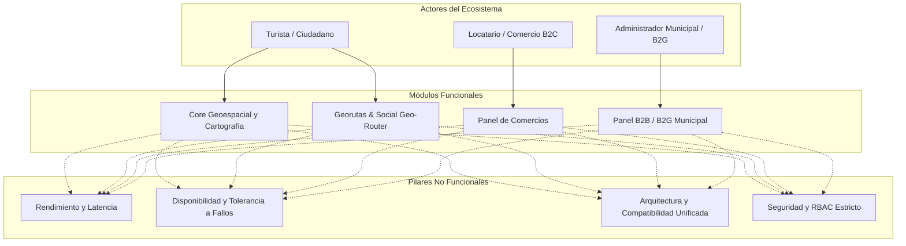
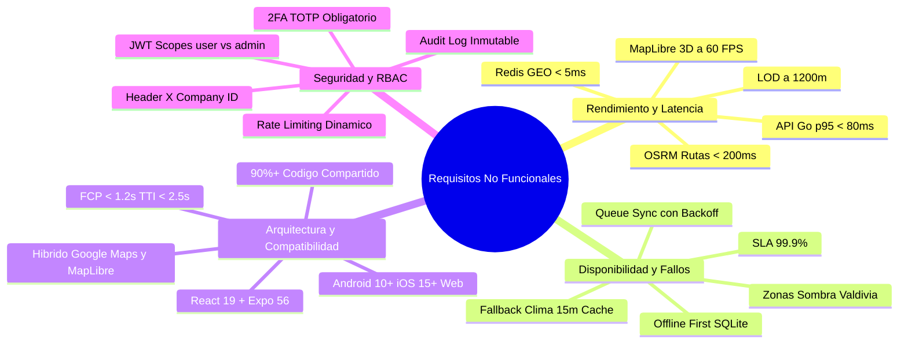
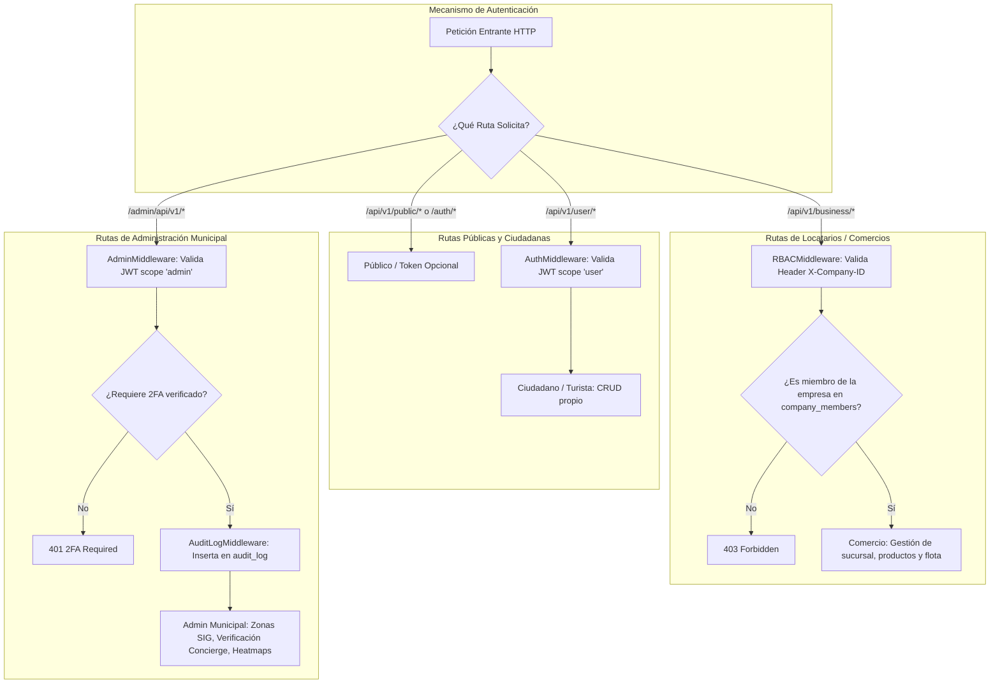

# Especificación Formal de Requisitos Funcionales (RF) y No Funcionales (RNF)
## Proyecto: App Turismo Map (ValdiTurismo) — Plataforma Geoespacial Multiplataforma B2B2C / B2G

| Atributo | Detalle |
| :--- | :--- |
| **Proyecto** | App Turismo Map (Valdivia Turismo) |
| **Documento** | Especificación Formal de Requerimientos del Sistema (SRS) |
| **Versión** | 2.0 (Post-Levantamiento Inicial y Casos de Uso) |
| **Fecha de Emisión** | Octubre 2026 |
| **Líder Técnico / Arquitecto** | Tech Lead & Arquitecto de Software Cloud / SIG |
| **Estado** | Aprobado para Fase de Implementación y Evaluación Técnica |

---

## 1. Contexto y Objetivos del Documento

El presente documento formaliza los **Requisitos Funcionales (RF)** y **Requisitos No Funcionales (RNF)** del sistema **App Turismo Map**, vinculando el diagnóstico territorial inicial de Valdivia (ecosistema húmedo, fluvial y de selva valdiviana), los Casos de Uso consolidados y el levantamiento de información previo (REQ-01 a REQ-05).

A partir de esta línea base, se expande el alcance hacia los tres nuevos módulos estratégicos:
1. **Módulo de Georutas (Social Geo-Router)**: Trazado interactivo multimodal, compartición social y persistencia en PostGIS.
2. **Módulo de Panel de Comercios (B2C / Locatarios)**: Gestión de sucursales, promociones contextuales y seguimiento telemétrico de flotas fluviales/tours.
3. **Módulo de Panel B2B / B2G (Administración Municipal y SIG)**: Monitoreo territorial, verificación concierge, analítica de calor y geocercas comunales.



---

## 2. Requisitos Funcionales (RF)

Los requisitos funcionales se redactan bajo el estándar de Historias de Usuario con su identificador formal, actor beneficiario, descripción estructurada (*"Quiero... Para..."*), prioridad según metodología MoSCoW (*Must, Should, Could, Won't*) y criterios de aceptación verificables.

### 2.1. Módulo Core Geoespacial y Cartografía (Evolución de REQ-01 al REQ-05)

| ID | Requisito / Nombre | Actor | Descripción Funcional | Criterios de Aceptación | Prioridad |
| :--- | :--- | :--- | :--- | :--- | :--- |
| **RF-01**<br>*(ex REQ-01)* | **Ruteo Multimodal y Conexión Fluvial** | Ciudadano / Turista | *Quiero* que el planificador de rutas (`RouterHUD`) calcule itinerarios que combinen tramos a pie, ciclovías y cruces fluviales en lancha,<br>*Para* cruzar de forma eficiente los ríos Calle-Calle y Valdivia sin depender exclusivamente de puentes congestionados. | 1. El motor OSRM/Valhalla debe incorporar los muelles fluviales de Valdivia como nodos de transferencia válidos.<br>2. El sistema debe sugerir cruces fluviales si reducen el tiempo o kilometraje en más de un 25% respecto al rodeo terrestre.<br>3. Debe renderizar la línea de ruta diferenciando colores por tramo (terrestre vs fluvial). | **MUST** |
| **RF-02**<br>*(ex REQ-02)* | **Check-in Asistido con Tolerancia Forestal Dinámica** | Ciudadano / Turista | *Quiero* registrar mi asistencia a eventos o hitos turísticos mediante geolocalización sin falsos rechazos en zonas boscosas,<br>*Para* obtener insignias en mi pasaporte turístico aún bajo lluvia o densa vegetación. | 1. La app móvil captura y envía al endpoint `/api/v1/events/checkin` las coordenadas y el radio de error reportado (`accuracy`).<br>2. La consulta PostGIS utiliza un buffer dinámico: `ST_DWithin(geom_evento, geom_usuario, 25 + accuracy_usuario)`.<br>3. Previene duplicados en la tabla `event_attendance` para el mismo evento y usuario en el mismo día. | **MUST** |
| **RF-03**<br>*(ex REQ-03)* | **Integración de Capas Abiertas IDE Chile y OGC** | Ciudadano / Administrador | *Quiero* visualizar en el mapa capas oficiales de humedales urbanos protegidos, monumentos nacionales y parques,<br>*Para* conocer las restricciones y zonas de valor ecológico de la comuna de Valdivia. | 1. El backend/frontend consume servicios WMS/WFS o GeoJSON de IDE Chile y el Ministerio del Medio Ambiente.<br>2. Las geometrías poligonales se renderizan de forma vectorial semi-transparente sobre el mapa base sin bloquear la interacción con los pines. | **SHOULD** |
| **RF-04**<br>*(ex REQ-04)* | **Clustering Dinámico y Agregación Cartográfica** | Ciudadano / Turista | *Quiero* que los pines turísticos se agrupen de forma automática cuando alejo el zoom del mapa,<br>*Para* evitar la saturación visual (*pin overload*) y mantener fluida la interfaz táctil. | 1. En zoom < 12, agrupa puntos masivos usando clústeres discretos hexagonales (Uber H3 o Supercluster).<br>2. En zoom 12 a 15, muestra micro-clústeres por cuadra.<br>3. En zoom > 15, expande el 100% de los marcadores individuales estilizados (`ArtisticMarker`, `StoreMarker`). | **MUST** |
| **RF-05**<br>*(ex REQ-05)* | **Modo Desconectado (Offline-First) y Cola de Sincronización** | Ciudadano / Turista | *Quiero* continuar navegando por el mapa y guardando lugares cuando esté sin señal celular en parques como Oncol o Niebla,<br>*Para* no perder mi progreso ni quedar desorientado en la selva valdiviana. | 1. Almacena en caché local las teselas cartográficas previamente descargadas.<br>2. Muestra el componente `OfflineIndicator` notificando el estado de red.<br>3. Las operaciones de guardado y check-in se encolan en almacenamiento local (SQLite/AsyncStorage) y se sincronizan al recuperar conexión. | **MUST** |

---

### 2.2. Módulo Georutas (Social Geo-Router)

| ID | Requisito / Nombre | Actor | Descripción Funcional | Criterios de Aceptación | Prioridad |
| :--- | :--- | :--- | :--- | :--- | :--- |
| **RF-06** | **Creación y Edición Interactiva de Georutas** | Ciudadano / Creador / Comercio | *Quiero* trazar georutas personalizadas sobre el mapa marcando waypoints sucesivos y eligiendo el modo de transporte (caminata, bicicleta),<br>*Para* diseñar itinerarios temáticos (ej. "Ruta de Cafés con Chimenea", "Circuito Cervecero"). | 1. Genera un registro en la tabla `routes` con geometría `LineString` (EPSG:4326) y calcula la distancia métrica total y duración estimada.<br>2. Permite nombrar, categorizar y añadir notas descriptivas a cada hito intermedio de la ruta.<br>3. Admite edición interactiva arrastrando puntos en pantalla. | **MUST** |
| **RF-07** | **Gestión de Visibilidad y Compartición Social** | Ciudadano / Creador | *Quiero* definir la privacidad de mis rutas (pública, no listada o privada) y compartirlas mediante enlaces web directos o QR,<br>*Para* distribuirlas a mis amigos o seguidores sin que usuarios no autorizados accedan a rutas privadas. | 1. Asigna un `share_token` criptográfico (UUID v4) a cada ruta no listada/pública.<br>2. Permite compartir directamente 1 a 1 mediante la tabla `route_shares` especificando permisos (`view` o `edit`).<br>3. Endpoint `/api/v1/routes/share/:token` accesible públicamente vía deep link sin requerir sesión para solo lectura. | **MUST** |
| **RF-08** | **Pasaporte Turístico, Guardado y Valoración de Rutas** | Ciudadano / Turista | *Quiero* guardar rutas sugeridas en mi Pasaporte Turístico, calificarlas con estrellas (1 a 5) y marcarlas como "Completadas",<br>*Para* llevar un registro de mis viajes y ayudar a otros turistas con recomendaciones fidedignas. | 1. Persistencia en `user_saved_routes` con estados `planned` y `completed`.<br>2. Endpoint `/api/v1/routes/:id/rate` que actualiza el promedio `rating_avg` en tiempo real evitando votos duplicados por usuario.<br>3. Muestra badge de "Ruta Verificada" si fue creada por un guía local certificado. | **SHOULD** |
| **RF-09** | **Exportación e Interoperabilidad de Rutas** | Turista Deportivo / Senderista | *Quiero* exportar el trazado de cualquier ruta pública en formato estándar **GPX** y **GeoJSON**,<br>*Para* cargarlo en relojes deportivos (Garmin, Suunto) o apps de senderismo de terceros. | 1. Genera archivos descargables válidos con elevación, coordenadas y marcas de tiempo.<br>2. Los metadatos incluyen nombre de ruta, creador y puntos de interés clave del trayecto. | **COULD** |

---

### 2.3. Módulo Panel de Comercios (Locatarios / B2C)

| ID | Requisito / Nombre | Actor | Descripción Funcional | Criterios de Aceptación | Prioridad |
| :--- | :--- | :--- | :--- | :--- | :--- |
| **RF-10** | **Gestión Multi-Sucursal Físicas y Coordenadas** | Locatario / Socio (`partner_owner`) | *Quiero* dar de alta múltiples sucursales de mi empresa indicando dirección, coordenadas PostGIS, teléfono y tipología indoor/outdoor,<br>*Para* que los turistas me ubiquen con exactitud en el mapa de Valdivia. | 1. Inserción y actualización en `company_branches` con tipo `GEOGRAPHY(Point, 4326)`.<br>2. Validación de que el usuario autenticado posee rol `owner` o `admin` en la empresa vía header `X-Company-ID`.<br>3. Atributo `is_indoor` para sugerir automáticamente el local en días de lluvia torrencial. | **MUST** |
| **RF-11** | **Catálogo de Productos y Promociones Dinámicas Contextuales** | Locatario (`partner_owner`/`partner_worker`) | *Quiero* publicar mi carta de productos y lanzar promociones por tiempo limitado vinculadas a condiciones ambientales,<br>*Para* atraer clientes en momentos de baja afluencia o días lluviosos (ej. "20% en café si llueve"). | 1. CRUD en tablas `products` y `promotions` asociadas a una `branch_id`.<br>2. El motor de recomendaciones (`/api/v1/recommendations`) prioriza promociones activas de locales con `is_indoor: true` cuando llueve en Valdivia.<br>3. Permite activar/desactivar promociones con un solo toque desde la app de negocios. | **MUST** |
| **RF-12** | **Geolocalización en Tiempo Real de Flotas Fluviales y Servicios Móviles** | Locatario de Turismo Fluvial / Guía | *Quiero* transmitir la posición satelital en vivo de mi embarcación turística o tour guiado mediante telemetría continua,<br>*Para* que los pasajeros esperando en los muelles costanera vean la lancha aproximándose en el mapa. | 1. Endpoint `/api/v1/business/location/update` y canal WebSocket que actualiza la posición en memoria Redis.<br>2. En el mapa del turista, el pin de la embarcación se desplaza suavemente con interpolación de coordenadas y ángulo de proa. | **SHOULD** |
| **RF-13** | **Creación y Difusión de Eventos Comerciales** | Locatario (`partner_owner`) | *Quiero* programar catas de cerveza, música en vivo o ferias gastronómicas con fecha de inicio, término y georreferencia,<br>*Para* que aparezcan en el carrusel de eventos y en la capa de eventos del mapa general. | 1. Inserción en tabla `events` asociando `branch_emitter_id` y `company_id`.<br>2. Validación de solapamiento de horarios y formato de fechas UTC.<br>3. Soporte para subir afiche promocional almacenado en object storage. | **MUST** |
| **RF-14** | **Gestión de Colaboradores e Invitaciones de Staff** | Locatario (`partner_owner`) | *Quiero* invitar a los dependientes de mi local mediante un enlace seguro generado desde mi panel,<br>*Para* que puedan actualizar la disponibilidad de productos sin darles permisos de administración sobre la empresa. | 1. Genera un token criptográfico en la tabla `invitations` con expiración de 48 horas.<br>2. El empleado acepta la invitación en `/api/v1/invitations/accept` y es registrado en `company_members` con rol `worker`.<br>3. El locatario puede revocar el acceso de cualquier trabajador en cualquier instante. | **MUST** |

---

### 2.4. Módulo Panel B2B / B2G (Administración Municipal y Gestión Territorial)

| ID | Requisito / Nombre | Actor | Descripción Funcional | Criterios de Aceptación | Prioridad |
| :--- | :--- | :--- | :--- | :--- | :--- |
| **RF-15** | **Verificación Concierge y Otorgamiento de Insignias** | Administrador Municipal (`admin_users`) | *Quiero* auditar las solicitudes de registro de comercios y otorgarles la Insignia de Confianza (Check de Verificación),<br>*Para* proteger el mapa contra el comercio informal no regulado y el spam turístico. | 1. Interfaz en `/admin/empresas` con listado de empresas con `verification_status: 'pending'`.<br>2. Endpoint `POST /admin/api/v1/companies/verify` que cambia el estado a `verified` y activa `is_verified_badge: true`.<br>3. El cambio se refleja instantáneamente en los marcadores del mapa público. | **MUST** |
| **RF-16** | **SIG Territorial y Delimitación de Geocercas Comunales** | Administrador Municipal | *Quiero* trazar y conmutar zonas poligonales activas/inactivas (humedales protegidos, ferias costaneras, zonas de seguridad),<br>*Para* restringir o habilitar zonas de interés sobre el visor cartográfico municipal. | 1. CRUD en `/admin/api/v1/zones` con soporte de polígonos GeoJSON en PostGIS.<br>2. Capacidad de alternar el estado (`active: true/false`) con propagación en tiempo real a las aplicaciones móviles y web. | **MUST** |
| **RF-17** | **Analítica Territorial y Mapas de Calor de Afluencia** | Administrador Municipal | *Quiero* consultar mapas de calor (Heatmaps) y tendencias de flujos peatonales generadas a partir de las sesiones anónimas de mapa,<br>*Para* tomar decisiones de planificación urbana y gestión de congestión turística en la Costanera e Isla Teja. | 1. Endpoints `/admin/api/v1/kpis` y `/admin/api/v1/trends` que agregan datos de `map_activity_sessions`.<br>2. Visualización cartográfica con gradiente térmico de intensidad basado en densidad de interacciones espaciales.<br>3. Filtrado por rango temporal (diario, semanal, estacional). | **SHOULD** |
| **RF-18** | **Gestión de Fauna Silvestre e Incidentes Ciudadanos** | Administrador Municipal / Guardaparques | *Quiero* monitorear y gestionar reportes de presencia de fauna silvestre (lobos marinos en caleta, pudúes, cisnes de cuello negro) o incidentes en vías fluviales,<br>*Para* coordinar cuadrillas municipales y advertir oportunamente a los turistas. | 1. CRUD y activación de tipos de fauna en `/admin/api/v1/fauna-types`.<br>2. Moderación de reportes de ciudadanos en `map_reports` con opción de cierre forzado o marcado como advertencia comunal prioritaria. | **SHOULD** |
| **RF-19** | **Bitácora Inmutable de Auditoría (Audit Trail)** | Administrador Municipal / SysAdmin | *Quiero* que cada acción de moderación, verificación o alteración de datos quede registrada de forma inalterable con usuario, IP y fecha,<br>*Para* cumplir con la normativa de transparencia y control de gestión del municipio. | 1. Cada petición administrativa ejecutada a través de `AdminMiddleware` inserta un registro en la tabla `audit_log`.<br>2. La vista `/admin/audit-log` permite buscar y filtrar eventos por administrador, fecha o tipo de acción. | **MUST** |

---

## 3. Requisitos No Funcionales (RNF)

Los evaluadores técnicos y de acreditación universitaria y gubernamental exigen **métricas precisas, verificables y sujetas a Acuerdos de Nivel de Servicio (SLA)**. A continuación se desglosan en profundidad los cuatro pilares fundamentales solicitados.



---

### 3.1. Rendimiento y Latencia (Alta Concurrencia y Carga Espacial)

El software debe garantizar una experiencia instantánea incluso durante hitos de alta demanda (ej. Semana Valdiviana, Noche Valdiviana con más de 100,000 personas en la ciudad).

| ID | Parámetro | Métrica Objetivo / Límite de Aceptación | Mecanismo Técnico de Cumplimiento |
| :--- | :--- | :--- | :--- |
| **RNF-01.1** | **Latencia de Endpoints Espaciales en Go** | **p95 < 80 ms**<br>**p99 < 150 ms**<br>Bajo carga de 2,000 req/s concurrentes. | * Indexación espacial `GiST` en todas las columnas de geometría (`events.geom`, `company_branches.geom`, `routes.geom`).<br>* Sustitución de cálculos trigonométricos en memoria por funciones nativas PostGIS (`ST_DWithin`, `ST_Intersects`).<br>* Limitación de payload mediante Bounding Box (`ST_MakeEnvelope`) para evitar traer datos fuera de pantalla. |
| **RNF-01.2** | **Cálculo Concurrente de Georutas (OSRM)** | **Tiempo de cálculo < 200 ms** por solicitud de ruta hasta 10 waypoints. | * Pool asíncrono de trabajadores en Go para resolver peticiones al motor OSRM local.<br>* Caché en Redis de rutas frecuentes (ej. Costanera a Isla Teja) con expiración de 24 horas.<br>* Compresión Polyline6 en la respuesta de red para reducir el peso del JSON transferido a menos de 5 KB. |
| **RNF-01.3** | **Tasa de Cuadros en Renderizado 3D (FPS)** | **60 FPS constantes** (mínimo admisible: 45 FPS en transiciones bruscas de pitch/cámara). | * En Web: Renderizado mediante WebGL en MapLibre GL utilizando la capa nativa `building-3d` con transiciones de extrusión (`fill-extrusion-height-transition: 150ms`).<br>* En Móvil: Aceleración por GPU nativa a través de React Native Maps sobre OpenGL ES / Metal. |
| **RNF-01.4** | **Nivel de Detalle Dinámico (LOD) y Culling 3D** | **Límite de extrusión < 1,200 metros** radiales desde el punto central de cámara. | * Algoritmo `updateBuildingLOD`: Solo extruye volúmenes 3D cuando el ángulo de cámara (pitch) supera los 15° y el zoom es ≥ 15.<br>* Culling de frustum: Todo edificio fuera del campo visual de la cámara o más allá del radio límite se renderiza como footprint 2D plano, eliminando sobrecarga en la GPU del cliente. |
| **RNF-01.5** | **Latencia de Telemetría y Alertas Proximidad** | **Respuesta < 10 ms** en consultas de radar de eventos cercanos. | * Utilización de Redis GEO (`GEORADIUS` / `GEOSEARCH`) en lugar de consultas directas a disco.<br>* Consumo de memoria en Redis optimizado para mantener menos de 20 MB por cada 10,000 entidades conectadas simultáneamente. |

---

### 3.2. Disponibilidad y Tolerancia a Fallos (Resiliencia en Territorio Húmedo)

Valdivia presenta dos desafíos geográficos de alto impacto: microclima con lluvias torrenciales repentinas y extensas zonas de "sombra" de cobertura celular en reservas naturales (Parque Oncol, Punucapa, Humedal Trumao, Costa de Niebla, Corral, Parque Saval y navegación fluvial).

#### A. Estrategia de Funcionamiento Offline o Cobertura Inestable

• **Riesgo:** En Valdivia y sus alrededores (Niebla, Corral, Parque Saval, Humedales o navegación por el río), existen zonas con intermitencia o pérdida total de señal 4G/5G.
• **Recomendación:** La documentación actual no define explícitamente una estrategia de caché de teselas vectoriales (vector tiles offline). Convendría definir que MapLibre pre-descargue un paquete base (.mbtiles de baja resolución del centro urbano) en el almacenamiento local de la app móvil para que el mapa no quede gris al perder conexión.

| ID | Escenario de Falla | Comportamiento del Sistema y Tolerancia | Mitigación Arquitectónica |
| :--- | :--- | :--- | :--- |
| **RNF-02.1** | **Caída o Latencia de la API Meteorológica Externa (Open-Meteo)** | **Degradación Elegante (Graceful Degradation)**:<br>El sistema nunca debe responder con error HTTP 500 ni bloquear el arranque de la app si el servicio meteorológico falla o agota el timeout de 3 segundos. | * **Circuit Breaker y Stale-While-Revalidate en Backend**: La función `IsRainingInValdivia()` en Go mantiene una caché en memoria de 10 a 15 minutos sincronizada con `sync.RWMutex`. Si la llamada a Open-Meteo arroja timeout, retorna el último estado climático registrado en caché.<br>* **Caché en Cliente (`weatherUtils.ts`)**: El frontend almacena la última predicción en `sessionStorage` con un TTL de 15 minutos y un radio de tolerancia de 10 km. Si todo falla, la UI muestra un estado neutral ("Clima templado en Valdivia") con ícono estático sin romper la vista del mapa. |
| **RNF-02.2** | **Pérdida de Señal Móvil en Parques y Ríos (Zonas Ciegas / Cobertura Inestable)** | **Operación Offline-First Completa**:<br>El usuario debe poder consultar la cartografía base de la zona sin pantallas en gris, visualizar sus georutas guardadas y registrar nuevos hitos turísticos sin conexión activa a internet. | * **Pre-descarga de Paquete Base (.mbtiles)**: MapLibre pre-descarga un paquete base vectorial (`.mbtiles` de baja/media resolución zoom 0–14 de Valdivia, Isla Teja, Costanera, Niebla, Corral y Humedales) en el almacenamiento local móvil (`FileSystem.documentDirectory`), impidiendo que el visor quede en gris ante pérdidas de 4G/5G.<br>* **Caché Híbrida de Teselas en Disco**: MapLibre almacena en caché local (`IndexedDB` en web, `FileSystem` en Android/iOS) las teselas vectoriales de alta resolución recorridas con política LRU.<br>* **Cola Transaccional Desconectada**: Si `useNetworkStatus` detecta desconexión, las mutaciones (check-in de eventos, creación de georuta, guardado de favoritos) se encolan con identificador UUID temporal en SQLite/AsyncStorage.<br>* **Sincronización en Ráfagas (Background Sync)**: Al restablecerse la conexión 3G/4G/WiFi, un worker en segundo plano vacía la cola mediante peticiones idempotentes con backoff exponencial. |
| **RNF-02.3** | **Caída del Servidor de Base de Datos PostgreSQL** | **Resiliencia Operativa**: El servidor API no debe sufrir caídas abruptas (*kernel panic*) ante cortes transitorios del pool de conexiones de Postgres. | * Implementación de `database.DB.Ping()` no bloqueante en arranque y pool de reintentos exponenciales.<br>* Manejo de panic a nivel de servidor HTTP mediante `RecoveryMiddleware` en Go, retornando JSON estructurado `503 Service Unavailable` a los clientes en lugar de romper el proceso. |
| **RNF-02.4** | **Disponibilidad Anual Global (SLA B2G)** | **Uptime ≥ 99.9%** (tiempo de inactividad no planificado inferior a 8.76 horas al año). | * Configuración de contenedores con healthchecks automáticos en Docker/Kubernetes.<br>* Proxy inverso Nginx con balanceo de carga y reenvío de tráfico activo-pasivo. |

---

### 3.3. Arquitectura, Compatibilidad y Multiplataforma

El sistema debe operar de forma armónica desde un único repositorio base, ofreciendo una experiencia fluida e idéntica tanto en pantallas táctiles móviles como en navegadores de escritorio.

```mermaid
graph LR
    subgraph Frontend Universal (Expo 56 + React 19)
        W[Navegador Web Desktop/Mobile] -->|MapLibre GL + CARTO Dark Matter| ML[WebGL 3D Engine]
        A[Android 10+] -->|React Native Maps| G1[Hardware Accelerated Map]
        I[iOS 15+] -->|React Native Maps| G2[Hardware Accelerated Map]
    end

    subgraph Estilos y Componentes
        W & A & I --- NW[NativeWind v4 + Tailwind CSS]
        W & A & I --- ID[Island Design Components]
    end

    subgraph Backend Unificado (Go 1.26)
        ML & G1 & G2 -->|REST API + WebSockets| BE[Go HTTP Engine]
        BE --> PG[(PostGIS + PostgreSQL)]
        BE --> RD[(Redis 7 Cache & GEO)]
    end
```

| ID | Parámetro | Estándar de Calidad / Requisito Técnico |
| :--- | :--- | :--- |
| **RNF-03.1** | **Paridad de Código Unificado** | **≥ 90% de código fuente compartido** entre Android, iOS y Web mediante el uso de React Native con Expo Router y `react-native-web`. |
| **RNF-03.2** | **Motor de Mapas Híbrido Multiplataforma** | * **Móvil (Android / iOS)**: Integración con cartografía nativa acelerada por hardware (Google Maps) con Supercluster nativo, garantizando gestos táctiles de 60 FPS y cero consumo de cuota web.<br>* **Web (Escritorio / Móvil Web)**: Motor de teselas vectoriales de alto rendimiento (**MapLibre GL**) con estilo CARTO Dark Matter y renderizado WebGL 3D sin costo de licenciamiento por visualización. |
| **RNF-03.3** | **Tiempos de Carga Iniciales (Web)** | * **First Contentful Paint (FCP)**: < 1.2 segundos.<br>* **Largest Contentful Paint (LCP)**: < 2.2 segundos.<br>* **Time to Interactive (TTI)**: < 2.5 segundos en conexiones de banda ancha estándar (50 Mbps).<br>* Aplicación de *code-splitting* y *lazy loading* dinámico para aislar librerías pesadas (MapLibre, Deck.gl, Lucide Icons). |
| **RNF-03.4** | **Tiempos de Carga Iniciales (Móvil)** | * Tiempo de transición desde Splash Screen hasta el mapa interactivo: **< 2.0 segundos** en dispositivos de gama media (ej. procesadores equivalentes a Snapdragon 680 con 4 GB de RAM). |
| **RNF-03.5** | **Compatibilidad de Plataformas y Versiones** | * **Android**: Compatibilidad nativa con Android 10 (API Level 29) en adelante.<br>* **iOS**: Compatibilidad con iOS 15.0 en adelante.<br>* **Navegadores Web**: Compatibilidad completa con navegadores modernos Evergreen (Google Chrome 100+, Mozilla Firefox 100+, Safari 15+, Microsoft Edge 100+). |
| **RNF-03.6** | **Diseño Responsivo e Island Design** | Interfaz adaptativa: En móvil utiliza controles anclados en base inferior accesibles con una sola mano (Thumb Zone); en escritorio expande menús laterales flotantes y maximiza el canvas cartográfico. |

---

### 3.4. Seguridad y Control de Acceso Basado en Roles (RBAC)

La plataforma maneja diferentes niveles de sensibilidad: desde la navegación anónima de un turista hasta el control territorial de un inspector municipal y la gestión comercial de un locatario.



| ID | Dimensión de Seguridad | Requisito Técnico y Mecanismo de Aislamiento |
| :--- | :--- | :--- |
| **RNF-04.1** | **Esquema de Autenticación Criptográfica** | * Emisión de tokens **JSON Web Tokens (JWT)** firmados con algoritmo HS256/RS256.<br>* Tokens de usuario ciudadano: Validez máxima de 72 horas con almacenamiento seguro en `expo-secure-store` en móvil y cookies `HttpOnly`/`SameSite: Strict` en web.<br>* Soporte nativo para OAuth 2.0 / Google Identity Services mediante verificación criptográfica del `idToken` en el servidor Go. |
| **RNF-04.2** | **Separación Estricta de Dominios (RBAC)** | Tres niveles de control jerárquico totalmente desacoplados:<br>1. **Ciudadano (`citizen`)**: No puede emitir peticiones a rutas `/admin/` ni `/business/` sin credencial de membresía.<br>2. **Locatario (`partner_owner` / `partner_worker`)**: Obligatoriedad del header `X-Company-ID` en cada llamada. El middleware `RBACMiddleware` valida en PostgreSQL (`company_members` y `role_permissions`) que el usuario posea facultades sobre el ID de la empresa enviada, impidiendo el escalamiento horizontal entre locatarios rivales.<br>3. **Administrador Municipal (`admin` / `superadmin`)**: El token JWT debe contener de forma explícita el claim `scope: "admin"`. El middleware `AdminMiddleware` bloquea cualquier token originado en los formularios estándar de ciudadanos o comercios. |
| **RNF-04.3** | **Autenticación en Dos Pasos Obligatoria (2FA / TOTP)** | * Requisito ineludible para roles administrativos municipales y cuentas con atribuciones territoriales (`admin_users`).<br>* Proceso gestionado íntegramente en el servidor en Go: Tras validar usuario y contraseña, se emite un `TempToken` (expiración: 5 minutos) y el backend exige el código TOTP de 6 dígitos antes de liberar el JWT definitivo con permisos administrativos. |
| **RNF-04.4** | **Protección contra Abuso y Rate Limiting** | * **AuthRateLimiter**: Límite de 5 intentos fallidos de inicio de sesión por minuto por dirección IP, bloqueando la IP temporalmente durante 15 minutos.<br>* **APIRateLimiter**: Límite de 120 solicitudes por minuto para consultas generales y 300 solicitudes por minuto para transmisión de telemetría de flotas por WebSocket. |
| **RNF-04.5** | **Cifrado de Datos en Tránsito y Reposo** | * Comunicaciones obligatorias bajo **HTTPS / TLS 1.3** con cabeceras de seguridad estrictas (`HSTS`, `X-Content-Type-Options: nosniff`, `Content-Security-Policy`).<br>* Contraseñas en reposo cifradas mediante **bcrypt con factor de costo 12**.<br>* Identificadores públicos de compartición generados como UUID v4 criptográficos no secuenciales para mitigar ataques de enumeración (IDOR). |
| **RNF-04.6** | **Trazabilidad y Registro de Auditoría Legal** | Toda operación administrativa (aprobación de comercio, conmutación de geocercas, eliminación de eventos) registra obligatoriamente: `admin_id`, `ip_address`, `user_agent`, `action_type`, `payload_diff` y `timestamp` en la tabla inmutable `audit_log`. |

---

## 4. Matriz de Trazabilidad (Actores vs Casos de Uso vs RF vs RNF)

Esta matriz demuestra a los evaluadores la coherencia integral entre los actores del sistema, los casos de uso definidos en la arquitectura y los requisitos del software.

| Actor | Caso de Uso Vinculado | Requisitos Funcionales (RF) | Requisitos No Funcionales Críticos (RNF) |
| :--- | :--- | :--- | :--- |
| **Turista / Ciudadano** | CU-01: Explorar Mapa y Navegación Fluvial | RF-01, RF-04 | RNF-01.1, RNF-01.3, RNF-03.2 |
| **Turista / Ciudadano** | CU-02: Check-in Asistido en Eventos / Selva | RF-02, RF-05 | RNF-01.5, RNF-02.2 |
| **Turista / Ciudadano** | CU-03: Crear y Compartir Georutas | RF-06, RF-07, RF-08, RF-09 | RNF-01.2, RNF-04.1 |
| **Locatario Comercial** | CU-04: Administrar Sucursales y Zonas | RF-10, RF-11 | RNF-04.2 (Aislamiento Multi-Tenant) |
| **Locatario Comercial** | CU-05: Transmitir Telemetría de Lanchas/Tours | RF-12, RF-13, RF-14 | RNF-01.5, RNF-04.4 (Rate Limiting) |
| **Administrador Municipal** | CU-06: Verificación Concierge de Comercios | RF-15, RF-19 | RNF-04.2, RNF-04.6 (Audit Log) |
| **Administrador Municipal** | CU-07: Control SIG, Geocercas y Clima | RF-03, RF-16, RF-18 | RNF-02.1 (Fallback Clima), RNF-01.4 |
| **Administrador Municipal** | CU-08: Analítica de Afluencia y Heatmaps | RF-17, RF-19 | RNF-01.1, RNF-04.3 (2FA Obligatorio) |

---

## 5. Criterios de Aceptación para Evaluación Técnica

Para certificar ante comisiones evaluadoras que la implementación satisface los requerimientos:

1. **Prueba de Resiliencia Climática (Circuit Breaker):** Al simular una caída de Open-Meteo desconectando la red del servidor o bloqueando el DNS de la API meteorológica, el endpoint `/api/v1/weather` debe retornar el último clima en caché con código `200 OK` (o fallback informativo) en menos de 20 ms, sin lanzar excepciones no controladas.
2. **Prueba de Modo Desconectado (Offline Selva Valdiviana):** Al activar "Modo Avión" en el dispositivo móvil dentro de la ruta del Parque Oncol, el mapa debe continuar renderizando las teselas cacheadas, permitir marcar waypoints y guardar la georuta localmente. Al desactivar el Modo Avión, los datos deben sincronizarse contra el backend sin intervención del usuario en menos de 3 segundos.
3. **Prueba de Carga y Concurrencia de Rutas:** Someter el endpoint de cálculo de rutas y consulta de edificios 3D a una prueba de estrés con 1,000 peticiones concurrentes (usando herramientas como *k6* o *Vegeta*). El percentil 95 de respuesta del servidor Go debe mantenerse por debajo de los 80 ms con 0% de errores de conexión.
4. **Prueba de Penetración y RBAC Multi-Tenant:** Intentar consultar o editar una sucursal del comercio `A` utilizando las credenciales JWT de un locatario del comercio `B` forzando el header `X-Company-ID: A`. El servidor debe retornar taxativamente un código `403 Forbidden`.
5. **Prueba de Verificación 2FA de Administrador:** Intentar acceder a cualquier ruta bajo `/admin/api/v1/*` únicamente con usuario y contraseña omitiendo el paso de verificación TOTP. La respuesta debe denegar el acceso con código `401 Unauthorized` / `twoFactorRequired: true`.
