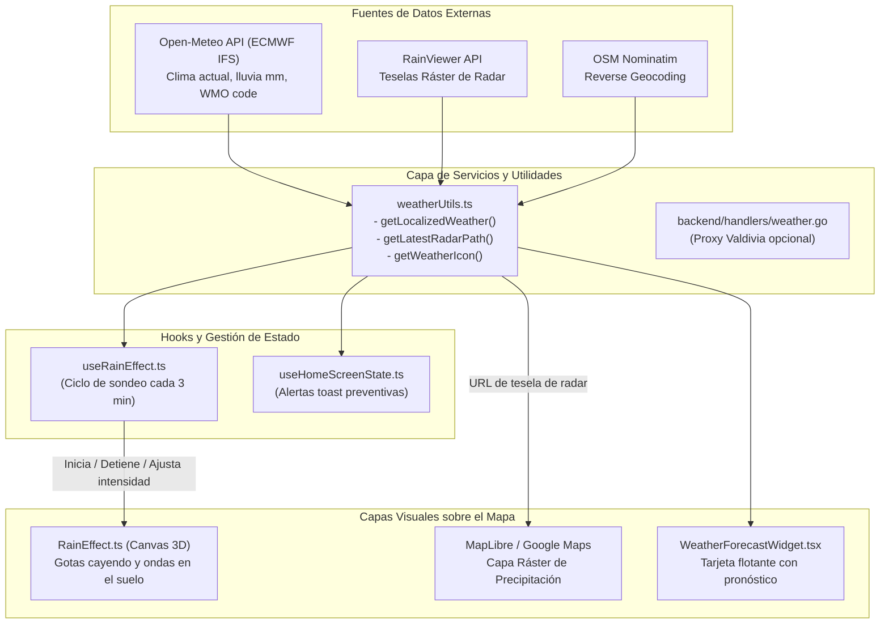

# Sistema de Clima y Efecto de Lluvia en el Mapa

Este documento describe la arquitectura, orígenes de datos, lógica de activación y motor de renderizado gráfico que dan vida al **sistema de clima y lluvia sobre el mapa** en **App Turismo Map**.

---

## 🗺️ Visión General de la Arquitectura

El sistema meteorológico está compuesto por dos capas visuales complementarias y un motor de datos en tiempo real:



---

## 1. Fuentes de Datos Meteorológicos

### A. Open-Meteo API (Datos en Tiempo Real y Pronóstico)
* **Archivo:** [`app-turismo/src/utils/weatherUtils.ts`](file:///grivyzom/webs/app-turismo-map/app-turismo/src/utils/weatherUtils.ts) -> función [`getLocalizedWeather`](file:///grivyzom/webs/app-turismo-map/app-turismo/src/utils/weatherUtils.ts#L60).
* **Endpoint consultado:**
  ```text
  https://api.open-meteo.com/v1/forecast?latitude={lat}&longitude={lon}&current=temperature_2m,relative_humidity_2m,apparent_temperature,precipitation,rain,weather_code,wind_speed_10m,wind_direction_10m,wind_gusts_10m&hourly=temperature_2m,precipitation_probability,rain,wind_speed_10m,weather_code&models=ecmwf_ifs&timezone=America%2FSantiago
  ```
* **Ubicación por defecto:** Valdivia, Chile (`lat: -39.8142`, `lon: -73.2459`).
* **Modelo meteorológico:** `ecmwf_ifs` (modelo europeo de alta precisión).
* **Parámetros extraídos:**
  * `weather_code`: Código WMO (Organización Meteorológica Mundial) para clasificar la condición meteorológica.
  * `rain`: Milímetros de precipitación líquida acumulada en la hora.
  * `precipitation`: Precipitación total.
  * `temperature_2m` y `apparent_temperature`: Temperatura real y sensación térmica.
  * `relative_humidity_2m`: Humedad relativa.
  * `wind_speed_10m`, `wind_direction_10m`, `wind_gusts_10m`: Viento a 10 metros del suelo.
  * Calidad del aire (`us_aqi`) consultada a la API paralela de `air-quality-api.open-meteo.com`.

### B. RainViewer API (Teselas Satelitales de Precipitación)
* **Archivo:** [`app-turismo/src/utils/weatherUtils.ts`](file:///grivyzom/webs/app-turismo-map/app-turismo/src/utils/weatherUtils.ts) -> función [`getLatestRadarPath`](file:///grivyzom/webs/app-turismo-map/app-turismo/src/utils/weatherUtils.ts#L188).
* **Endpoint de metadatos:** `https://api.rainviewer.com/public/weather-maps.json`.
* **Función:** Obtiene el timestamp y ruta del cuadro de radar satelital más reciente (`data.radar.past[last].path`), evitando errores HTTP 400 por alias desfasados.
* **Capa de teselas (Tiles):**
  ```text
  https://tilecache.rainviewer.com{radarPath}/256/{z}/{x}/{y}/1/1_1.png
  ```

### C. Proxy de Respaldo en Go (Backend)
* **Archivo:** [`backend/handlers/weather.go`](file:///grivyzom/webs/app-turismo-map/backend/handlers/weather.go).
* **Función:** [`GetWeatherHandler`](file:///grivyzom/webs/app-turismo-map/backend/handlers/weather.go#L11).
* **Propósito:** Ofrecer un endpoint HTTP interno en el servidor que consulte Open-Meteo con coordenadas fijas de Valdivia para clientes que naveguen a través de VPNs o conexiones remotas.

---

## 2. Detección y Criterios de Lluvia

La determinación de si debe llover sobre el mapa se basa en el estándar **WMO Weather Interpretation Codes**:

```typescript
// app-turismo/src/utils/useRainEffect.ts
const isRainingCode = (code: number): boolean => {
  return (
    (code >= 51 && code <= 55) || // Llovizna leve a densa
    (code >= 61 && code <= 65) || // Lluvia leve, moderada a fuerte
    (code >= 80 && code <= 82)    // Chubascos violentos o aislados
  );
};
```

* **Intensidad de lluvia:** Si el código confirma lluvia, se calcula la intensidad visual normalizada entre 0 y 1:
  $$\text{intensity} = \min\left(1, \frac{\text{current.rain}}{10}\right)$$
  Esta intensidad ajusta directamente la velocidad del viento y la densidad de gotas simuladas.

---

## 3. Motor Gráfico: Efecto de Lluvia en Scene View (`RainEffect.ts`)

* **Ubicación:** [`app-turismo/src/utils/rainEffect.ts`](file:///grivyzom/webs/app-turismo-map/app-turismo/src/utils/rainEffect.ts).
* **Tipo:** Clase en TypeScript puro sobre la Canvas 2D Context API con anclaje espacial geográfico y física de escena.

### A. Concepto de "Scene View" (Vista de Escena)
A diferencia de un efecto 2D adherido al cristal de la cámara ("efecto parabrisas"), el sistema modela el mapa como una **escena tridimensional** observada desde el cielo:
* **El Terreno es la Escena:** Se encuentra a nivel $z = 0$ (el suelo geográfico del mapa).
* **El Cielo Simulado:** Existe a una cota de altitud virtual superior ($h = 1.0$), por encima de cada punto del mapa.
* **Caída Real hacia el Suelo:** Las gotas se generan en el cielo y caen verticalmente (con deriva de viento) dirigiéndose hacia sus coordenadas geográficas exactas de aterrizaje (`targetLng`, `targetLat`).
* **Anclaje al Mapa:** Al arrastrar el mapa (*pan*), rotarlo (*bearing*) o inclinarlo (*pitch*), tanto las trayectorias de caída como los anillos de onda en el suelo se recalculan en tiempo real usando `map.project()`, permaneciendo fijos sobre las calles y terreno del mapa en lugar de flotar sobre el lente de la cámara.

### B. Proyección y Profundidad 3D
Para cada partícula:
1. **Punto Terrestre en Pantalla:** Se proyecta la coordenada geográfica del impacto:
   $$(gx, gy) = \text{map.project}([\text{targetLng}, \text{targetLat}])$$
2. **Escala de Profundidad ($\text{depthScale}$):** Debido al ángulo de *pitch* (inclinación de la cámara), los puntos superiores de la pantalla representan terreno más lejano hacia el horizonte:
   $$\text{depthScale} = \text{clamp}\left(0.45 + 0.55 \times \frac{gy}{\text{viewportHeight}}, 0.35, 1.25\right)$$
3. **Cielo Simulado:** La altura virtual de la nube en píxeles de pantalla se calcula en función del pitch y la profundidad:
   $$\text{ceilingHeight} = (220 + 160 \times \sin(\theta_{\text{pitch}})) \times \text{depthScale}$$
4. **Trayectoria de la Gota:**
   $$\text{headY} = gy - (\text{altitude} \times \text{ceilingHeight})$$
   $$\text{headX} = gx + (\text{altitude} \times \text{windScreenX} \times \text{depthScale})$$
   La cola de la gota (*tail*) se extiende hacia arriba en el cielo, indicando la procedencia natural de la lluvia.

### C. Ondas de Impacto en el Terreno (`WaveScene`)
* Cuando $\text{altitude} \le 0$, la gota impacta el suelo en $(\text{targetLng}, \text{targetLat})$.
* Se genera una onda expansiva en el plano del mapa:
  * Radio horizontal: $r_x = r \times \text{depthScale}$.
  * Radio vertical: $r_y = r_x \times \cos(\theta_{\text{pitch}})$.
  Esto produce elipses aplanadas que reposan perfectamente sobre la superficie tridimensional inclinada del mapa.
* Si el usuario desplaza el mapa durante la vida de la onda (~550 ms), la onda se desplaza sincronizada con el terreno.

### D. Control de Visibilidad por Zoom LOD (Cerca vs Lejos)
Físicamente, las gotas individuales impactando contra calles y esquinas solo tienen sentido cuando el usuario observa la escena de cerca (a nivel de barrio o calle). Desde una vista lejana (regional, satelital o macro), el efecto se desvanece para dar paso a efectos globales (radar satelital, bancos de niebla o nubes):
* **$\text{Zoom} \le 12.0$ (Lejos / Macro):** La lluvia de partículas se apaga por completo ($\text{zoomFade} = 0$, opacidad 0%). El canvas se limpia y el motor omite los cálculos de trazado en GPU/CPU.
* **$12.0 < \text{Zoom} < 13.5$ (Transición):** Desvanecimiento gradual suave:
  $$\text{zoomFade} = \frac{\text{currentZoom} - 12.0}{13.5 - 12.0}$$
* **$\text{Zoom} \ge 13.5$ (Cerca / Calles):** Opacidad 100% con física completa de impacto y perspectiva.
* **Animación GTA V:** Al ascender a altura satelital ($\text{zoom} = 8.5$), la lluvia desaparece; al caer en picada hacia el marcador del usuario ($\text{zoom} = 16.8$), la lluvia atraviesa el umbral de las nubes y aparece suavemente en pantalla.

---

## 4. Hook Controlador: `useRainEffect.ts`

* **Ubicación:** [`app-turismo/src/utils/useRainEffect.ts`](file:///grivyzom/webs/app-turismo-map/app-turismo/src/utils/useRainEffect.ts).
* **Integrado en:** [`app-turismo/src/components/Map/MapLibreContainer.web.tsx`](file:///grivyzom/webs/app-turismo-map/app-turismo/src/components/Map/MapLibreContainer.web.tsx#L261).

### Responsabilidades:
1. **Polling Automático:** Ejecuta `checkWeather()` al montar y cada 3 minutos (`setInterval(checkWeather, 180000)`).
2. **Debounce de Transición:** Evita encendidos/apagados bruscos mediante una ventana de debounce de 1000 ms (`toggleDebounceMs`).
3. **Sincronización con la Cámara:** Se suscribe a los eventos del mapa MapLibre:
   * `map.on('move', syncCamera)`
   * `map.on('zoom', syncCamera)`
   * `map.on('rotate', syncCamera)`
   * `map.on('pitch', syncCamera)`
   Actualiza la distancia focal y los ángulos en la simulación de partículas en tiempo real.

---

## 5. Capa Cartográfica de Radar en MapLibre (`MapLibreContainer.web.tsx`)

Cuando el usuario activa la visualización meteorológica (`showWeather = true`) y el modo precipitación (`weatherType = 'precipitation'`):

1. Se consulta `getLatestRadarPath()` para obtener el identificador de tiempo de RainViewer.
2. Se inyecta una fuente ráster y una capa en MapLibre:
   ```typescript
   map.addSource('weather-tile-source', {
     type: 'raster',
     tiles: [`https://tilecache.rainviewer.com${radarPath}/256/{z}/{x}/{y}/1/1_1.png`],
     tileSize: 256,
     maxzoom: 12,
   });

   map.addLayer({
     id: 'weather-tile-layer',
     type: 'raster',
     source: 'weather-tile-source',
     paint: { 'raster-opacity': 0.6 },
   });
   ```

---

## 6. Notificaciones y Widget de Clima

* **Alertas Preventivas:** En [`useHomeScreenState.ts`](file:///grivyzom/webs/app-turismo-map/app-turismo/src/hooks/useHomeScreenState.ts#L698), la función `checkRain` analiza el pronóstico de las siguientes 4 horas. Si detecta condiciones de chubascos o lluvia persistente, emite una notificación toast:
  > *"Se pronostica lluvia en Valdivia en las próximas horas."*
* **Widget Flotante:** [`WeatherForecastWidget.tsx`](file:///grivyzom/webs/app-turismo-map/app-turismo/src/components/MapUI/WeatherForecastWidget.tsx) consume el mismo modelo `ZoneWeather`, desplegando la temperatura actual, calidad del aire (AQI) y pronóstico horario con iconos dinámicos (`rainy`, `thunderstorm`, etc.).

---

## 7. Motor WebGL Nativo: Custom Layer de MapLibre (`Rain3DLayer.ts`)

* **Ubicación:** [`app-turismo/src/utils/rain3dLayer.ts`](file:///grivyzom/webs/app-turismo-map/app-turismo/src/utils/rain3dLayer.ts).
* **Tipo:** Implementación de `CustomLayerInterface` de MapLibre GL 5.x (`renderingMode: '3d'`).
* **Soporte en Hook:** [`useRainEffect.ts`](file:///grivyzom/webs/app-turismo-map/app-turismo/src/utils/useRainEffect.ts) soporta selector de motor con `mode: 'webgl3d' | 'canvas2d'`.

### A. Ventajas Arquitectónicas respecto a Canvas 2D
1. **Cero costo de CPU en proyección:** No existen llamadas iterativas a `map.project()`. La GPU calcula la posición en paralelo de >4.500 gotas en microsegundos.
2. **Sincronización Total con el Pipeline de MapLibre:** Dibuja directamente en el buffer WebGL del mapa, compartiendo matriz de cámara, oclusión y tasa de refresco (60/120 Hz).
3. **Escala y Perspectiva Conformal:** Responde de forma nativa a rotaciones violentas (`bearing`), cabeceo (`pitch` hasta 70°) y traslación rápida.

### B. Blindaje de Bajo Nivel y Optimizaciones de Producción

#### 1. Matriz RTC (Relative-to-Center) en 64 bits (Cero Jittering a Zoom $\ge 16$)
A zooms microscópicos ($\ge 16$), la precisión de punto flotante de 32 bits en la GPU se desborda contra las coordenadas Mercator globales $[0, 1]$, produciendo vibración espuria (*jittering*).
* **Solución RTC:** Se computa en la CPU en doble precisión (64-bit IEEE 754):
  $$M' = M \times T(c_x, c_y, 0)$$
  donde $(c_x, c_y)$ es la coordenada Mercator del centro de la cámara. La GPU solo evalúa desplazamientos locales métricos pequeños en el rango $[-450, 450]\text{ m}$.

#### 2. Escala Conformal Mercator en el Eje $Z$
En Web Mercator, la cota vertical debe escalarse conformalmente a la latitud de la escena:
$$\text{meterScale} = \text{centerCoord.meterInMercatorCoordinateUnits}()$$
Tanto la altura de nubes ($140\text{ m}$) como la longitud de la estela ($3.8\text{ m}$) y el viento se modulan por este factor antes de transmitirse al shader.

#### 3. Topología `gl.LINES` con Gradiente de Estela
Se instancian 2 vértices por partícula en un VBO estático:
* Vértice 0 (Cabeza / Suelo): `a_vertex_type = 0.0`
* Vértice 1 (Cola / Nube): `a_vertex_type = 1.0`
El Vertex Shader interpola la altura con `fract()` y aplica un gradiente de opacidad: cabeza nítida y luminosa, cola difuminada hacia el cielo.

#### 4. Suavizado Radial Perimetral (Smooth Edge Falloff)
Para evitar que las partículas desaparezcan o aparezcan bruscamente ("popping") en los bordes del volumen durante paneos violentos o vuelos cinemáticos, el vertex shader modula el canal alfa con una caída suave:
```glsl
float distToCenter = length(a_local_seed.xy);
float edgeFade = smoothstep(u_volume_radius, u_volume_radius * 0.80, distToCenter);
v_alpha = streakFade * entryFade * u_zoom_fade * u_intensity * edgeFade;
```

#### 5. Aislamiento Estricto de Estados WebGL
MapLibre altera dinámicamente el `STENCIL_TEST`, `SCISSOR_TEST` y `CULL_FACE` entre capas de mosaicos. `Rain3DLayer` captura el estado previo con `gl.isEnabled()`, los desactiva para el trazado de líneas y los restaura exactamente después de `gl.drawArrays()`:
```typescript
const stencilEnabled = gl.isEnabled(gl.STENCIL_TEST);
const scissorEnabled = gl.isEnabled(gl.SCISSOR_TEST);
const cullFaceEnabled = gl.isEnabled(gl.CULL_FACE);

if (stencilEnabled) gl.disable(gl.STENCIL_TEST);
if (scissorEnabled) gl.disable(gl.SCISSOR_TEST);
if (cullFaceEnabled) gl.disable(gl.CULL_FACE);

gl.depthMask(false); // No contamina el depth buffer; permite mezclar capas inferiores
gl.drawArrays(gl.LINES, 0, this.dropCount * 2);
gl.depthMask(true);

if (stencilEnabled) gl.enable(gl.STENCIL_TEST);
if (scissorEnabled) gl.enable(gl.SCISSOR_TEST);
if (cullFaceEnabled) gl.enable(gl.CULL_FACE);
```

#### 6. Resiliencia de Contexto (`webglcontextlost` y `webglcontextrestored`)
En navegadores móviles o por saturación de memoria GPU, el canvas de MapLibre puede revocar el contexto. `Rain3DLayer` escucha los eventos nativos:
* `webglcontextlost`: Invalida punteros a `program` y `buffer`, y llama a `event.preventDefault()` para autorizar la restauración.
* `webglcontextrestored`: Re-ejecuta `onAdd(map, gl)` reconstruyendo limpiamente shaders, atributos y VBOs.

#### 7. Repaint Condicional (Consumo 0% en Reposo)
`map.triggerRepaint()` únicamente se ejecuta si la lluvia está activa, su intensidad es mayor a cero y el zoom actual es $\ge 12.0$. De lo contrario, MapLibre no redibuja el mapa continuamente, reduciendo el consumo de batería a 0% en reposo.

---

### C. Checklist de Validación para Producción

| Componente | Validación Requerida | Estado |
| :--- | :--- | :--- |
| **RTC 64-bit Matrix** | Sin vibración ni salto subpíxel a zoom 20+ | ✅ Resuelto |
| **Depth Buffer Isolation** | Las gotas no ocultan edificios 3D ni bloquean popups | ✅ Resuelto |
| **Energy Profile** | Consumo 0% de GPU en reposo / zoom macro | ✅ Resuelto |
| **Pérdida de Contexto** | Recreación limpia de VBOs en `contextrestored` | ✅ Resuelto |
| **Borde de Volumen RTC** | Desvanecimiento suave perimetral (`edgeFade`) | ✅ Resuelto |
| **Zoom LOD** | 100% visible $\ge 13.5$, fade gradual $12.0 \to 13.5$, 0% $\le 12.0$ | ✅ Resuelto |

---

## 8. Resiliencia de Datos Meteorológicos (`weatherUtils.ts`)

* **Caché en `sessionStorage`:** Clave `app-turismo.weather-cache-v1` con un tiempo de vida (TTL) de **15 minutos**.
* **Radio Geográfico de Tolerancia (10 km):** Mediante la fórmula Haversine, el sistema verifica si la nueva posición del usuario dista menos de 10 km de la última consulta. Dado que los modelos atmosféricos como ECMWF operan en celdas de varios kilómetros, no se saturan las cuotas con llamadas HTTP redundantes al desplazarse por la ciudad.
* **Fallback Tolerante a Fallos:** En caso de corte de red, error de conexión o agotamiento de cuota, el sistema preserva la última medición en caché en lugar de desactivar abruptamente el clima.

---

## 9. Atmósfera Urbana y Niebla Volumétrica (`map.setSky`)

MapLibre GL provee la API `map.setSky(skyOptions)` para modular la atmósfera y el horizonte según las condiciones de lluvia:
* **Lluvia Moderada / Intensa ($\ge 5\text{ mm/h}$):** Modula el horizonte y la niebla con tonos plomizos (`fog-color: '#718096'`, `fog-ground-blend: 0.7`, `atmosphere-blend: 0.9`), generando la sensación de campo visual reducido por precipitación urbana.
* **Vista Macro ($\text{zoom} < 12.0$):** Disipación de la niebla baja para dar paso a la visualización despejada del radar satelital RainViewer.
