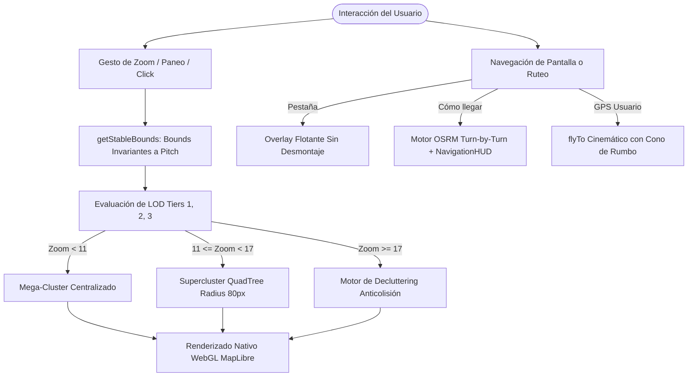
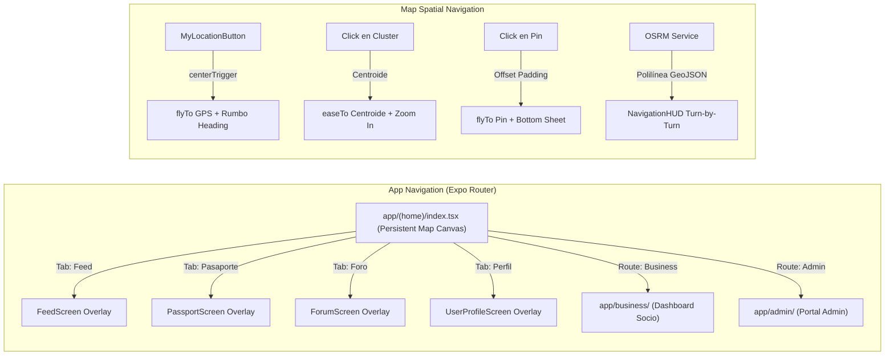
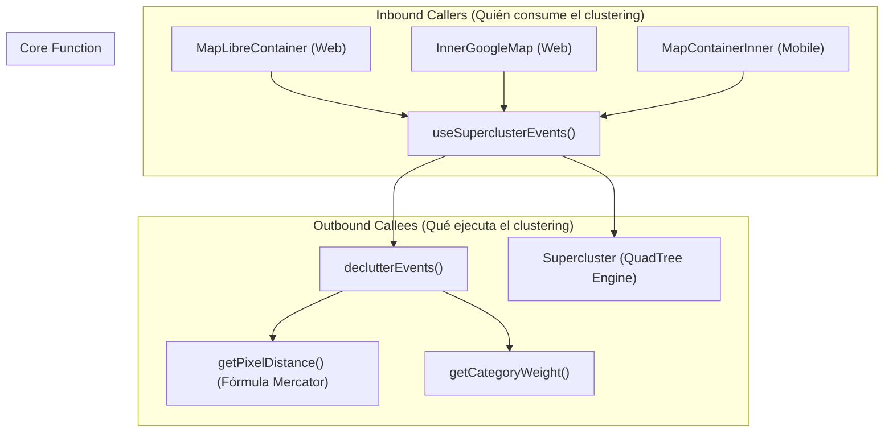

# Motor de Zoom y Sistema de Navegación Integral

Este documento constituye la referencia técnica definitiva sobre el funcionamiento del **Motor de Zoom** (cálculo espacial, LOD, anticolisión y renderizado reactivo) y del **Sistema de Navegación** (ruteo de pantallas sin desmontaje, cinemática de cámara, navegación turn-by-turn con OSRM y menús orbitales contextuales) en la aplicación **App Turismo Map**.

---

## 1. Resumen Ejecutivo y Filosofía de Diseño

La experiencia de usuario de la plataforma se fundamenta en dos pilares arquitectónicos esenciales:

1. **Persistent Canvas ("Zero-Unmount"):** El mapa interactivo (`MapContainer`) se mantiene permanentemente montado en el árbol del DOM y WebGL como un telón de fondo viviente. Las vistas del sistema (Feed, Pasaporte, Foros, Perfiles y Eventos) no sustituyen la pantalla, sino que flotan sobre ella como paneles desacoplados con carga diferida (`Suspense` + `lazyWithRetry`). Esto garantiza **0 ms de latencia en transiciones** y elimina por completo la recreación de contextos WebGL y la recarga de teselas (tiles).
2. **Nivel de Detalle Adaptativo (LOD Geoespacial):** La cantidad de información visual en pantalla está estrictamente gobernada por el nivel de zoom y el ángulo de inclinación tridimensional (*pitch*). Desde un único mega-cluster de ciudad hasta la elevación dinámica en 3D de marcadores individuales y decluttering por jerarquías, el motor optimiza el presupuesto de renderizado para sostener **60 FPS** estables en dispositivos móviles y navegadores de escritorio.



---

## 2. El Motor de Zoom en el Mapa

El sistema implementa una arquitectura **Multi-Provider** ([mapConfig.ts](file:///grivyzom/webs/app-turismo-map/app-turismo/src/config/mapConfig.ts)) que opera con **MapLibre GL** en Web (renderizado nativo por GPU con shaders) y **React Native Maps** / **Google Maps** en dispositivos móviles y entornos alternativos.

### 2.1 Modelo Matemático y Conversión de Zoom

#### A. Entorno Web (MapLibre / Google Maps JS)
El nivel de zoom $z$ es un valor en punto flotante continuo ($z \in [1, 20]$). Cada incremento unitario de zoom duplica el nivel de detalle y reduce a la mitad el área visible:
$$\text{escala} = 2^z$$

#### B. Entorno Móvil (React Native Maps - Proyección Delta WGS84)
React Native Maps no consume un número entero o escalar de zoom de forma nativa en todas las plataformas, sino un rango angular definido por `latitudeDelta` y `longitudeDelta`. En [MapContainer.tsx](file:///grivyzom/webs/app-turismo-map/app-turismo/src/components/Map/MapContainer.tsx), el motor realiza la conversión bidireccional mediante las siguientes fórmulas logarítmicas calibradas para la escala de Valdivia ($z_0 = 13$ como punto de equilibrio):

```typescript
// Conversión de Nivel de Zoom a Deltas de Coordenadas
const zoomToDeltas = (zoomLevel: number) => {
  const delta = 0.015 * Math.pow(2, 13 - zoomLevel);
  return {
    latitudeDelta: delta,
    longitudeDelta: delta * ASPECT_RATIO,
  };
};

// Conversión inversa: De Deltas a Nivel de Zoom
const calculatedZoom = Math.round(13 - Math.log2(region.latitudeDelta / 0.015));
```

---

### 2.2 Motor de Clustering y Tiers de LOD (`clusterUtils.ts`)

El agrupamiento y filtrado de eventos se procesa de forma reactiva en el hook `useSuperclusterEvents`:

| Nivel de Zoom | Nivel de Detalle (LOD) | Categorías Habilitadas | Comportamiento del Motor |
| :--- | :--- | :--- | :--- |
| **Zoom < 11** | **LOD 1 (Ciudad)** | Sólo emergencias y nodos críticos (`choque`, `incendio`, `accidente`, `calle_cortada`, `coliseo`, `puerto`, `fauna`). | Se genera un **Mega-Cluster central** en el centroide de todos los puntos para evitar saturar la vista macro. |
| **11 $\le$ Zoom < 14** | **LOD 2 (Barrios)** | Se incorporan puntos de esparcimiento y cultura (`cultura`, `naturaleza`, `publico`, `museo`, `teatro`, `deportes`, `tienda`). | Agrupación espacial con **Supercluster** (QuadTree espacial) con radio de 80 px y `minPoints: 2`. |
| **14 $\le$ Zoom < 17** | **LOD 3 (Calles)** | Apertura completa de categorías (`gastronomia`, `musica`, servicios). | Disolución progresiva de clusters en marcadores individuales a medida que aumenta el espacio en pantalla. |
| **Zoom $\ge$ 17** | **Decluttering Activo** | Todas las categorías + Cámaras de seguridad (`camara`). | **Supercluster se apaga**. Se activa el motor de tolerancia a colisiones por píxeles y pesos. |

#### A. Excepciones Deterministas del Clustering
*   **Embarcaciones (`embarcacion`):** Nunca se agrupan en clusters en ningún nivel de zoom. Se renderizan como entidades independientes con simulación de navegación cinemática y detección de colisión en tiempo real sobre superficies de agua. Son visibles a partir de `zoom >= 14`.
*   **Cámaras de Seguridad (`camara`):** Para evitar sobrecargar la interfaz ciudadana, solo se inyectan en el flujo cuando `zoom >= 17`.
*   **Parques y Reservas Naturales (`parque`, `reserva`):** Se mantienen siempre individuales pero restringidos estrictamente al Bounding Box (`bbox`) visible en pantalla para evitar saturación de memoria fuera de vista.

#### B. Algoritmo de Decluttering en Zooms Altos ($\ge 17$)
Cuando el usuario se acerca al nivel de calle, los clusters se disuelven, pero múltiples locales o reportes en la misma cuadra podrían solaparse. El algoritmo calcula la distancia euclidiana en píxeles sobre la proyección esférica de Mercator:

$$\text{worldSize} = 256 \times 2^{\text{zoom}}$$
$$x = \left(\frac{\text{lon} + 180}{360}\right) \times \text{worldSize}$$
$$y = \left(\frac{1 - \ln\left(\tan(\text{lat}_{\text{rad}}) + \sec(\text{lat}_{\text{rad}})\right) / \pi}{2}\right) \times \text{worldSize}$$
$$\text{distanciaPx} = \sqrt{(x_1 - x_2)^2 + (y_1 - y_2)^2}$$

Si $\text{distanciaPx} < 45\text{ px}$ (`COLLISION_TOLERANCE_PIXELS`), el motor compara los pesos de categoría definidos en `CATEGORY_WEIGHTS`:

```typescript
const CATEGORY_WEIGHTS: Record<string, number> = {
  choque: 100, incendio: 100, accidente: 100, calle_cortada: 100, // Emergencias (Prioridad Máxima)
  coliseo: 90, puerto: 90, fauna: 90,                             // Hitos Metropolitanos
  embarcacion: 85,                                               // Transporte Fluvial
  cultura: 70, naturaleza: 70, museo: 70, teatro: 70,             // Atractivos Turísticos
  publico: 60, deportes: 60,                                     // Equipamiento Cívico
  tienda: 50, gastronomia: 40, musica: 40,                        // Comercio y Ocio
};
```
El elemento con mayor peso prevalece en la pantalla y el colisionante de menor jerarquía se oculta dinámicamente.

---

### 2.3 Solución al Problema del Relieve 3D (Pitch) y Bounds Estables

#### El Problema de la Inclinación (Camera Pitch)
Al inclinar la cámara para ver la ciudad en perspectiva 3D (pitch de 0° a 60°), la función nativa `map.getBounds()` proyecta los rayos del frustum de la cámara hacia el horizonte, abarcando cientos de kilómetros de territorio lejano. Esto causaba que Supercluster incluyera de golpe miles de eventos distantes, alterando los centroides y provocando que los clusters **saltaran bruscamente de lugar al rotar o inclinar el mapa**.

#### La Solución: Bounds Teóricos Invariantes (`getStableBounds`)
Ubicado en [MapLibreContainer.web.tsx](file:///grivyzom/webs/app-turismo-map/app-turismo/src/components/Map/MapLibreContainer.web.tsx#L498-L534), el motor ignora por completo el pitch y calcula los límites geográficos teóricos sustentados únicamente en el centro geométrico y el zoom:

$$\text{latSpan} = \left(\frac{180}{2^z}\right) \times 1.5, \quad \text{lngSpan} = \left(\frac{360}{2^z}\right) \times 1.5$$

```typescript
const getStableBounds = () => {
  const center = map.getCenter();
  const z = map.getZoom();
  const latSpan = (180 / Math.pow(2, z)) * 1.5;
  const lngSpan = (360 / Math.pow(2, z)) * 1.5;
  return {
    minLat: Math.max(-85, center.lat - latSpan),
    maxLat: Math.min(85, center.lat + latSpan),
    minLng: Math.max(-180, center.lng - lngSpan),
    maxLng: Math.min(180, center.lng + lngSpan),
  };
};
```

Además, implementa un filtro de histéresis debounced (80 ms): únicamente recalcula el clustering si el centro se desplazó más de $0.0001^\circ$ o si el zoom varió más de $0.01$, eliminando por completo el jittering durante rotaciones.

---

### 2.4 Comportamiento Reactivo y Adaptación Visual (`updateAesthetics`)

El motor visual sincroniza la apariencia de los elementos con el zoom y el pitch en cada fotograma vía `requestAnimationFrame`:

1. **Capas Nativas WebGL (Mobiliario y Heatmap):**
   *   `mobiliario-layer` (bancas, basureros, bebederos, baños): Se mantiene apagado en zooms bajos (`minzoom: 15`). A partir de zoom 15, su opacidad se interpola linealmente:
       ```json
       ["interpolate", ["linear"], ["zoom"], 15, 0, 15.5, 1]
       ```
   *   `heatmap-layer`: Se intensifica de zoom 11 a 18 (`heatmap-intensity`: 1 a 3; `heatmap-radius`: 20 a 60 px) y se desvanece de forma transparente a partir de zoom 16 hasta apagarse en zoom 18 (`heatmap-opacity`: 0) para ceder el paso a los locales concretos.
2. **Smart Badges (Viñetas Inteligentes de Marcadores):**
   *   $z \ge 16$: Todas las viñetas se auto-expanden mostrando sus etiquetas de texto completas.
   *   $14.5 \le z < 16$: Solo se expanden las viñetas de alta prioridad (`en_vivo`, `oferta`).
   *   $z < 14.5$: Permanecen colapsadas en píldoras circulares de 16 px para evitar el abarrotamiento visual.
3. **Elevación Dinámica Tridimensional (Dynamic 3D Pop-Out):**
   Para destacar los pines seleccionados o bajo hover sobre los edificios 3D, su elevación en el eje vertical crece a medida que se aumenta el zoom:
   $$\text{elevationGrow} = (\text{zoom} - 13) \times 5.0 \quad (\text{para } z > 13)$$
   $$\text{elevaciónReal} = \sin\left(\frac{\text{pitch} \times \pi}{180}\right) \times (26 + \text{elevationGrow}) \times \text{zoomScale}$$
4. **Presupuesto de Animación (Animation Budget):**
   Si $z < 14$ o el conteo de marcadores en pantalla excede de 60, el motor activa la clase CSS `.pin-ambient-off` en los pines secundarios no críticos. Esto silencia las animaciones CSS infinitas (pulsos, halos y olas) y ahorra ciclos de GPU.

---

### 2.5 Control de Zoom en la Interfaz (UI HUD)

La aplicación provee un control de zoom flotante con diseño **Obsidian Glass** ([HomeScreen.tsx](file:///grivyzom/webs/app-turismo-map/app-turismo/app/(home)/index.tsx#L1310-L1370)):

*   **Botón Superior (+):** Ejecuta `setZoom((z) => Math.min(z + 1, currentMaxZoom))`.
*   **Track Táctil con 5 Puntos de Anclaje:** Barra vertical con indicador de llenado porcentual reactivo (`height: ((zoom - 1) / (currentMaxZoom - 1)) * 100%`) y 5 puntos discretos para saltar directamente a niveles preestablecidos.
*   **Botón Inferior (-):** Ejecuta `setZoom((z) => Math.max(z - 1, 1))`.
*   **Badge Digital:** Despliega en tiempo real la ampliación actual (`{zoom}x`).

---

## 3. El Sistema de Navegación Integral

El sistema de navegación opera en dos dimensiones complementarias: **Navegación de Pantallas y Aplicación** (Expo Router) y **Navegación Geoespacial y de Cámara** (movimiento cinemático y ruteo asistido).



---

### 3.1 Navegación de Aplicación (App Routing)

#### A. Arquitectura de Rutas en Expo Router (`app/`)
*   **`app/_layout.tsx`:** Layout raíz que envuelve la aplicación en los contextos esenciales: `AuthProvider`, `UserLocationProvider`, y gestión de splash screen.
*   **`app/(home)/_layout.tsx` & `index.tsx`:** El núcleo de la experiencia ciudadana.
*   **`app/(home)/user-search.tsx`:** Modal de búsqueda avanzada con soporte para lenguaje natural e inteligencia artificial.
*   **`app/(home)/notifications.tsx`:** Centro de notificaciones ciudadanas.
*   **`app/business/`:** Rutas protegidas para comerciantes (`dashboard.tsx`, `create-event.tsx`, `delimitar-zonas.tsx`, `geolocalizar.tsx`, `updates.tsx`).
*   **`app/admin/`:** Portal administrativo municipal.
*   **`app/onboarding.tsx`:** Captura de preferencias turísticas y cívicas en el primer arranque.

#### B. Patrón "Zero-Unmount" y Carga Predictiva
Para evitar que el mapa interactivo se destruya y reconstruya (lo que genera parpadeos blancos, latencia de conexión y re-descarga de MB en teselas de mapas):
1.  **Montaje Fijo:** `MapContainer` está ubicado en la raíz de `HomeScreen` y nunca se desmonta al cambiar entre las pestañas (`feed`, `saved`, `forum`, `profile`, `events`).
2.  **Pantallas como Capas de Superposición:** Las pantallas secundarias se cargan mediante `lazyWithRetry` envueltas en componentes `<Suspense>`.
3.  **Prefetching en Hover (Web):** Los botones de la barra de navegación ejecutan prefetch al pasar el cursor por encima (`onMouseEnter`):
    ```typescript
    const prefetchFeed = () => import('../../src/screens/FeedScreen');
    const prefetchSaved = () => import('../../src/screens/PassportScreen');
    const prefetchForum = () => import('../../src/screens/ForumScreen');
    const prefetchProfile = () => import('../../src/screens/UserProfileScreen');
    ```
    Cuando el usuario hace clic, el componente ya se encuentra disponible en memoria caché, brindando transiciones inmediatas de **0 ms**.

---

### 3.2 Navegación Espacial de Cámara en el Mapa

El motor expone métodos de control cinemático suave para orientar la vista del mapa según las acciones del usuario:

#### A. Centrado en Ubicación del Usuario (GPS MyLocation)
Al pulsar el botón `MyLocationButton` ([MyLocationButton.tsx](file:///grivyzom/webs/app-turismo-map/app-turismo/src/components/MapUI/MyLocationButton.tsx)):
1.  Se activa la precisión alta del sensor GPS (`Location.Accuracy.High`).
2.  Se dispara `centerTrigger` en el estado global.
3.  La cámara se desplaza cinematográficamente mediante:
    ```typescript
    map.flyTo({
      center: [userLocation.longitude, userLocation.latitude],
      zoom: 14,
      essential: true,
    });
    ```
4.  El marcador del usuario activa un cono de luz animado (`directionalCone`) que rota dinámicamente según la brújula interna del teléfono (`userLocation.heading`).

#### B. Navegación al Hacer Clic en un Cluster (Zoom al Centroide Real)
Al hacer clic en un cluster nativo, el motor **no** hace zoom a la coordenada de la celda de Supercluster, sino que extrae todas las hojas (`leaves`) contenidas y calcula el **centroide aritmético real**:
$$\text{Lat}_{\text{centroide}} = \frac{1}{n}\sum_{i=1}^n \text{Lat}_i, \quad \text{Lng}_{\text{centroide}} = \frac{1}{n}\sum_{i=1}^n \text{Lng}_i$$
La cámara se aproxima suavemente mediante:
```typescript
map.easeTo({
  center: [centroidLng, centroidLat],
  zoom: Math.min(map.getZoom() + 3, maxPossibleZoom - 1),
  duration: 600,
});
```

#### C. Enfoque de Pin Seleccionado
Al seleccionar un evento o comercio (ya sea desde la búsqueda, el carrusel inferior o el propio marcador):
*   La cámara vuela hacia el punto con elevación a $z \ge 16$:
    ```typescript
    map.flyTo({
      center: [selectedEvent.longitude, selectedEvent.latitude],
      zoom: Math.max(map.getZoom(), 16),
      essential: true,
    });
    ```
*   Se despliega el panel inferior `PlaceDetailsIsland`. El punto se centra considerando el espacio libre de la interfaz gráfica para no quedar ocluido por la tarjeta flotante.

#### D. Encuadre de Sectores y Rutas (`fitBounds`)
Al visualizar una ruta trazada o un sector municipal delimitado, la cámara calcula la envolvente convexa y se ajusta automáticamente con padding ergonómico:
```typescript
map.fitBounds([[minLng, minLat], [maxLng, maxLat]], {
  padding: { top: 100, bottom: 260, left: 60, right: 60 },
  duration: 800,
  maxZoom: 16,
});
```

#### E. Motor de Efectos Cinemáticos de Cámara (Aparición Estilo GTA V)
Implementado en [cameraAnimationEngine.ts](file:///grivyzom/webs/app-turismo-map/app-turismo/src/components/Map/camera/cameraAnimationEngine.ts), este motor cinemático optimizado gestiona las transiciones de perspectiva según el estado de sesión:

1. **Usuario Autenticado al Ingresar al Mapa (Spawn GTA V):**
   * **Fase 1 (Ascenso al Cielo / Vista Satelital):** La cámara se eleva rápidamente a vista aérea (`zoom: 11.8`, `pitch: 10°`, duración: 550 ms) con aceleración `ease-in-out`.
   * **Fase 2 (El "Swoop" / Picada GTA V):** Se abalanza en caída libre hacia las coordenadas del pin del usuario (`userLocation.longitude, userLocation.latitude`), alcanzando un `zoom: 16.8`, un `pitch: 48°` tridimensional y orientando el rumbo (`bearing`) al sensor de brújula (`heading`), con deceleración cúbica suave:
     ```typescript
     map.flyTo({
       center: [location.longitude, location.latitude],
       zoom: 16.8,
       pitch: 48,
       bearing: heading ?? 15,
       curve: 1.85, // Swoop acentuado característico de GTA V
       speed: 1.2,
       essential: true,
     });
     ```
2. **Usuario No Logueado (Invitado / Guest):**
   * La cámara permanece inerte en el centro de Valdivia (`VALDIVIA_LNG, VALDIVIA_LAT = -73.2459, -39.8142`) en vista normal predeterminada (`zoom: 13`, `pitch: 0°`, `bearing: 0°`) sin realizar zooms ni traslaciones automáticas.
3. **Cerrar Sesión / Logout (Transición Suave y Anti-Flash):**
   * **Persistencia Espacial:** La cámara preserva el centro y nivel de zoom actuales del mapa, evitando descargas de teselas fuera de caché, recargas de WebGL y flashes en pantalla.
   * **Nivelación Angular (Pitch Normalization):** Si la cámara se encontraba inclinada en vista 3D (`pitch > 0`), se reorienta suavemente hacia la vista cenital estándar (`pitch: 0°, bearing: 0°`, duración: 350 ms) manteniendo la posición sin marear al usuario.
4. **Activación Opcional y Persistencia:**
   * Las animaciones están **activas por defecto**, pero pueden desactivarse en cualquier momento desde el botón `Cámara GTA V` del cajón de herramientas o ajustes. La preferencia se persiste en disco local mediante `savePersistedCameraAnimations()` en [mapPreferences.ts](file:///grivyzom/webs/app-turismo-map/app-turismo/src/utils/mapPreferences.ts). Al desactivarse, las transiciones se convierten en reposicionamientos instantáneos sin animaciones ni mareos.
5. **Control de Sesión Anti-Espameo en Recargas (`sessionStorage`):**
   * **Prevención de Spawn en Refresh:** Para evitar que la animación completa (despegue a las nubes y clavado 3D) se ejecute repetidamente en cada recarga de página (F5/refresh), el motor consulta `hasCameraSpawnedInSession()`. En entornos Web, este valor se respalda en `window.sessionStorage` bajo la clave `app-turismo.camera-spawned`.
   * **Comportamiento en Recarga:** Si la clave ya está presente en la sesión activa de la pestaña, la cámara salta inmediatamente a la posición del usuario de forma silenciosa (`animated: false` / `jumpTo` directo a zoom 15.5) sin elevarse al cielo ni demorar la interacción.
   * **Reactivación en Nuevo Acceso / Login:** Al ejecutar un logout (`signOut()` o `executeMapLibreGtaVLogout`), se ejecuta `resetCameraSpawnInSession()`, eliminando la marca. Cuando el usuario vuelve a iniciar sesión ("accede"), la animación GTA V se ejecuta nuevamente de forma triunfal.

---

### 3.3 Sistema de Rutas y Navegación Turn-by-Turn (OSRM)

La aplicación incluye un motor de navegación peatonal y asistida sustentado en el servicio **OSRM** ([osrmService.ts](file:///grivyzom/webs/app-turismo-map/app-turismo/src/utils/osrmService.ts)) y dos componentes HUD especializados:

#### A. Motor de Cálculo Peatonal (`fetchOsrmRoute`)
1.  Consume la API de ruteo:
    `https://router.project-osrm.org/route/v1/foot/{originLng},{originLat};{destLng},{destLat}?geometries=geojson&steps=true&overview=full`
2.  Traduce y sintetiza localmente las maniobras (`depart`, `turn`, `roundabout`, `arrive`) al español con nombres de calles y modificadores de giro (`sharp right`, `slight left`, etc.).
3.  Retorna la polilínea completa en formato GeoJSON `LineString`, distancia total en metros, duración estimada en segundos y el arreglo de pasos detallados.

#### B. HUD de Navegación en Ruta (`NavigationHUD.tsx`)
Cuando el usuario presiona "Cómo llegar":
*   Se dibuja la polilínea en el mapa en una capa nativa WebGL con color personalizado.
*   Se despliega el `NavigationHUD` en la parte inferior mostrando:
    *   Nombre y color de la categoría de destino.
    *   Métricas en vivo: Distancia formateada (ej. `450 m`, `2.3 km`), tiempo estimado a pie y modo de traslado.
    *   Próxima maniobra inmediata con icono direccional (`firstStep.instruction`).
    *   Lista colapsable con el itinerario paso a paso (`route.steps`).
    *   Instrucción final de arribo al destino.

#### C. HUD de Creación y Trazado de Rutas (`RouterHUD.tsx`)
Herramienta avanzada pensada para administradores y comerciantes:
*   Permite seleccionar tipo de ruta: Circuito Cervecero, Reto Ciudadano, Ruta Turística o Exploración.
*   Traza rutas multi-destino (`multi_target`) permitiendo hacer clic en el mapa para añadir hitos sucesivos.
*   Calcula en tiempo real la distancia acumulada en metros utilizando la **fórmula del semiverseno (Haversine)** entre todos los nodos del trazado.

---

### 3.4 Micro-Navegación y Menús Contextuales

Para agilizar la navegación sin abandonar el mapa, se han integrado múltiples artefactos de micro-interacción:

1. **Menú Radial Contextual (`ContextualRadialMenu`):**
   *   Al hacer clic o tocar un marcador, se despliega una rueda orbital con 5 acciones inmediatas:
       *   🔍 **Ver Ficha / Detalles**
       *   🔖 **Guardar en Colección**
       *   🧭 **Cómo Llegar (Ruta OSRM)**
       *   🔗 **Compartir Enlace Directo**
       *   📍 **Registrar Check-In**
2. **Carrusel Inferior de Lugares (`BottomPlaceCarousel` / `PlacesShelf`):**
   *   Bandeja horizontal deslizable tipo estante en la zona inferior de la pantalla que exhibe los comercios y atractivos próximos calculados según la posición del usuario o del centro del mapa.
3. **Modales In-Situ (`MiniModal`, `StoreModal`, `AuthorityModal`):**
   *   Tarjetas compactas que se abren directamente ancladas al pin en el espacio 3D, mostrando estado en vivo, horarios de atención y botones de contacto rápido.
4. **Búsqueda Semántica con Teletransporte (`user-search.tsx`, `aiSearchParser.ts`):**
   *   Interpreta consultas complejas en lenguaje natural (ej. *"cafeterías cerca del río con wifi abiertas ahora"*).
   *   Permite teleportar instantáneamente la cámara del mapa al resultado elegido, sincronizando zoom y marcador activo en una sola animación.

---

## 4. Topología de Grafo y Trazabilidad del Código (Codebase Knowledge Graph)

A través del grafo de conocimiento del proyecto (`codebase-memory-mcp`), se han extraído las métricas de complejidad estática, acoplamiento y cadenas de invocación (inbound/outbound) para las funciones rectoras del zoom y la navegación:



### 4.1 Métricas de Complejidad y Flujos de Ejecución

| Función / Símbolo | Archivo de Origen | Complejidad Ciclomática | Complejidad Cognitiva | In-Degree | Out-Degree |
| :--- | :--- | :--- | :--- | :--- | :--- |
| `MapLibreContainer` | `src/components/Map/MapLibreContainer.web.tsx` | 322 | 598 | 1 | 30+ |
| `updateAesthetics` | `src/components/Map/MapLibreContainer.web.tsx` | 42 | 88 | 2 | 12 |
| `useSuperclusterEvents` | `src/utils/clusterUtils.ts` | 13 | 16 | 3 | 6 |
| `declutterEvents` | `src/utils/clusterUtils.ts` | 4 | 8 | 1 | 7 |
| `applyRoute` | `src/components/Map/MapLibreContainer.web.tsx` | 9 | 20 | 1 | 4 |
| `fetchOsrmRoute` | `src/utils/osrmService.ts` | 3 | 3 | 1 | 2 |
| `getStableBounds` | `src/components/Map/MapLibreContainer.web.tsx` | 1 | 1 | 2 | 0 |

### 4.2 Trazabilidad de Llamadas (Call Graph Insights)
1. **Punto de Entrada Unificado:** `useSuperclusterEvents` actúa como el cuello de botella central de clustering para los 3 contenedores (`MapLibreContainer`, `MapContainerInner` nativo y `InnerGoogleMap`). Ningún contenedor implementa clustering propio; la lógica de LOD es 100% agnóstica de la plataforma.
2. **Ciclo de Pintado Estético:** `updateAesthetics` se invoca mediante `requestAnimationFrame` enlazado a los eventos `'zoom'`, `'pitch'`, `'rotate'` y `'move'`. Su desacoplamiento mediante `aestheticsRafId` previene la saturación del render loop.
3. **Flujo de Ruteo OSRM:** `HomeScreen` es el orquestador principal que invoca `fetchOsrmRoute` ante la selección en el menú contextual o tarjeta de detalle, pasando la geometría resultante a `MapLibreContainer` mediante el prop reactivo `navRouteGeojson`.

---

## 5. Matriz Comparativa de Rendimiento y Parámetros Clave

| Parámetro / Componente | Configuración Implementada | Razón Arquitectónica |
| :--- | :--- | :--- |
| **Radio de Supercluster** | `80 px` | Equilibrio perfecto entre legibilidad y granularidad visual sin apelotonar etiquetas. |
| **Zoom Límite de Clustering** | `z = 18` (`maxZoom: 18`) | Disuelve todo cluster en pines puros antes de alcanzar el zoom máximo de calle. |
| **Tolerancia de Decluttering** | `45 px` | Evita la colisión física de pines SVG en zooms mayores a 17. |
| **Debounce de Bounds** | `80 ms` | Filtra micro-movimientos de paneo y rueda del mouse, evitando re-indexaciones superfluas. |
| **Umbral de Histéresis** | $\Delta\text{pos} \ge 0.0001^\circ, \Delta z \ge 0.01$ | Ignora oscilaciones por rotación o inclinación pura (pitch) de la cámara 3D. |
| **Presupuesto de Animación** | $z \ge 14$ y marcadores $\le 60$ | Desactiva animaciones secundarias en vistas amplias para garantizar 60 FPS estables. |
| **Padding de Encuadre de Ruta** | `{ top: 100, bottom: 260, left: 60, right: 60 }` | Garantiza que las polilíneas de ruta queden perfectamente visibles sin ser tapadas por los HUDs. |

---

## 6. Documentos Relacionados en el Espacio Obsidian

*   [[Arquitectura_Detallada_y_Funcionamiento]] — Estructura general de carpetas, contexto de autenticación y diseño Obsidian Glass.
*   [[SISTEMA DE CLUSTERING 3D]] — Detalles de alineación pitch y renderizado en canvas WebGL.
*   [[TELEMETRIA Y MAPLIBRE]] — Telemetría de sensores móviles, rumbos y modo táctico.
*   [[CONFIGURACION GOOGLE MAPS]] — Parámetros específicos y llaves de la API comercial de Google Maps.
*   [[Sistema de Colecciones y Ubicaciones Guardadas]] — Almacenamiento local y remoto de puntos de interés.
